<p align="center">
  <a href="https://github.com/kutsalkiremitci/robz-vision/releases/latest">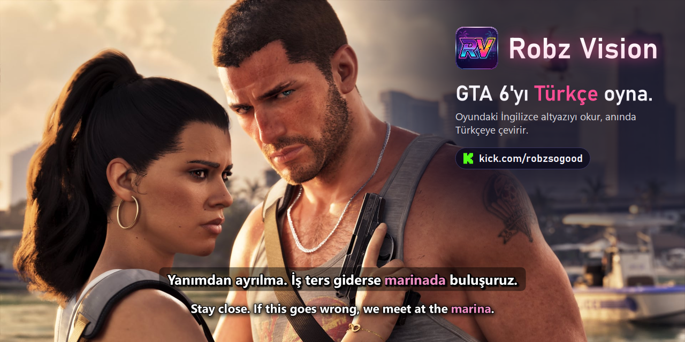</a>
</p>
<p align="center"><sub>Oyun görseli © Rockstar Games / Take-Two Interactive (GTA VI resmî tanıtım görseli). Altyazılar ve Türkçe
kutu Robz Vision'ın çizimidir. Robz Vision bağımsız bir hayran projesidir; Rockstar Games ile bir bağlantısı yoktur.</sub></p>

<h3 align="center">Oyundaki İngilizce altyazıyı ekrandan okur, anında Türkçeye çevirir.</h3>

<p align="center">
  Bilgisayarda ya da <b>PS Remote Play</b> ile oynadığınız oyunlarda çeviri oyunun üstünde belirir;<br>
  <b>Kick ve OBS</b> yayınında izleyicileriniz de görür. Ücretsiz, açık kaynak, Windows için.
</p>

<p align="center">
  <a href="https://github.com/kutsalkiremitci/robz-vision/releases/latest"></a>
  &nbsp;
  <a href="https://kick.com/robzsogood">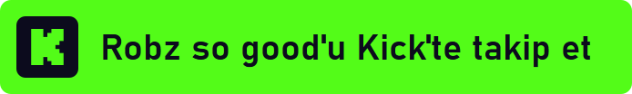</a>
</p>
<p align="center"><sub> Robz Vision'ı Kick yayıncısı <b>Robz so good</b>
geliştiriyor. Yeni sürümler ve güncellemeler önce yayında duyurulur; <a href="https://kick.com/robzsogood">kanalı takip ederek</a>
projeye destek olabilirsiniz.</sub></p>

<p align="center">
  <a href="https://github.com/kutsalkiremitci/robz-vision/releases/latest"></a>
  <a href="https://github.com/kutsalkiremitci/robz-vision/releases"></a>
  
  
  <a href="LICENSE"></a>
  <a href="https://kick.com/robzsogood"></a>
  <a href="https://kutsalkiremitci.github.io/robz-vision/"></a>
</p>

<p align="center"><sub>Windows 10 / 11, 64 bit (ARM'li Windows 11 dahil) · kurulum dosyası ya da taşınabilir zip/7z · yönetici izni istemez<br>
<a href="#nasıl-görünür">Nasıl görünür</a> · <a href="#neler-yapar">Neler yapar</a> · <a href="#3-adımda-başla">3 adımda başla</a> ·
<a href="#adım-adım-kurulum-rehberi">PS5 ve TV rehberi</a> · <a href="#kurulum">Kurulum</a> · <a href="#sss-ve-sorun-giderme">SSS</a> · <a href="docs/KULLANIM.md">Kullanım kılavuzu</a> ·
<a href="https://kutsalkiremitci.github.io/robz-vision/">Web sitesi</a></sub></p>

## Nasıl görünür

<p align="center">
  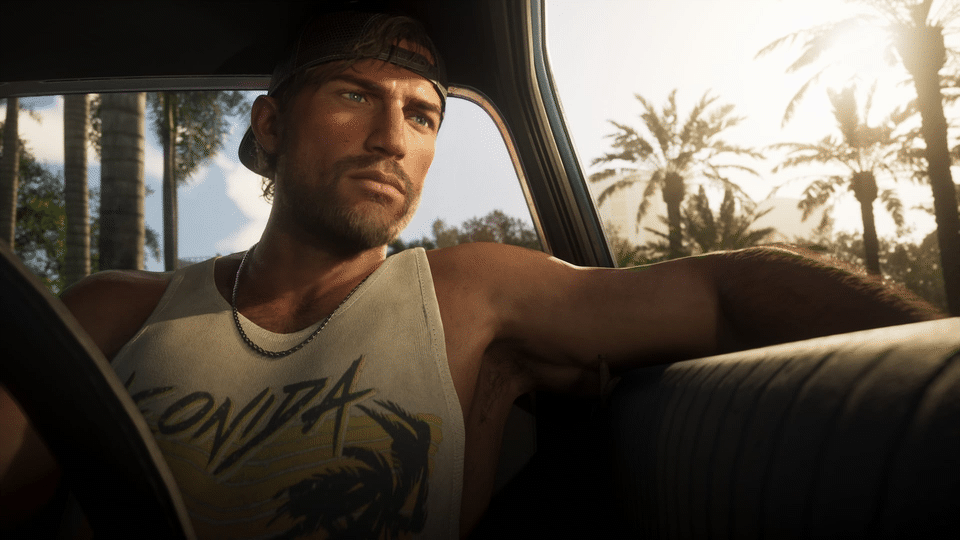
</p>
<p align="center"><sub>Altta oyunun İngilizce altyazısı, üstünde Robz Vision'ın Türkçe çevirisi; satır belirir, çevirisi gelir,
sonraki satıra geçilir. Son sahnede <i>Oyun altyazısının üzerine</i> kipi açık. Türkçe kutu uygulamanın kendi çizim koduyla
çizilmiştir (<code>tools/readme_gorselleri.py</code>); altyazı cümleleri örnektir, oyundan alıntı değildir.<br>
Oyun görseli © Rockstar Games / Take-Two Interactive.</sub></p>

<table>
  <tr>
    <td width="50%" valign="top">
      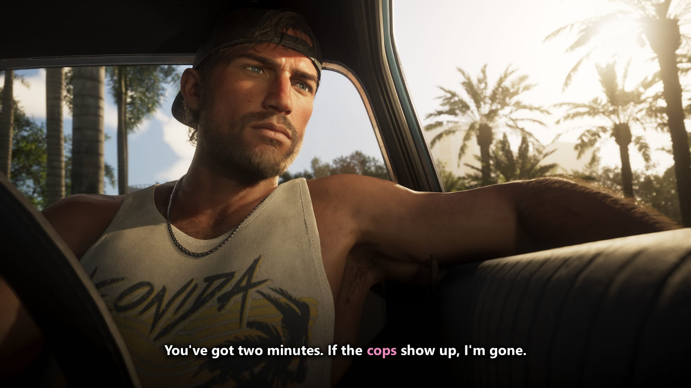<br>
      <sub><b>Önce:</b> oyunun kendi İngilizce altyazısı.</sub>
    </td>
    <td width="50%" valign="top">
      <br>
      <sub><b>Robz Vision açıkken:</b> Türkçe kutu, ekranınızda istediğiniz yerde. Oyunun pembe yazdığı kelime çeviride de pembe.</sub>
    </td>
  </tr>
  <tr>
    <td colspan="2" valign="top">
      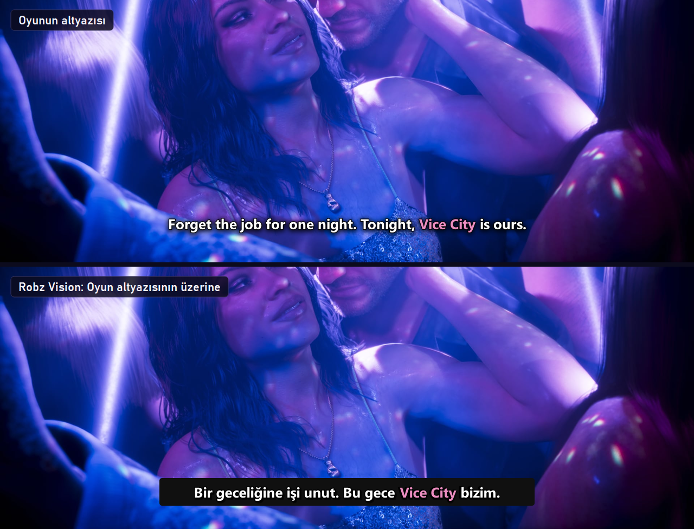<br>
      <sub><b>Oyun altyazısının üzerine</b> (<i>Görünüm → Yerleşim</i>, 1.3.0): Türkçe, İngilizcenin tam yerine yazılır. Koyu kutu
      İngilizceyi örter, oyunun yazısıyla aynı boydadır; oyun altyazıyı kaldırınca kutu da kalkar.</sub>
    </td>
  </tr>
</table>
<p align="center"><sub>Oyun görselleri © Rockstar Games / Take-Two Interactive (GTA VI resmî tanıtım görselleri).</sub></p>

<details>
<summary><b>Uygulamanın ekranları</b></summary>
<br>
<table>
  <tr>
    <td width="33%" valign="top">
      <br>
      <sub><b>Ana sayfa:</b> Başlat, bölge önizlemesi, son çeviriler, Ekranımda ve OBS; kenar çubuğunda sürüm ve Kick bağlantısı.</sub>
    </td>
    <td width="33%" valign="top">
      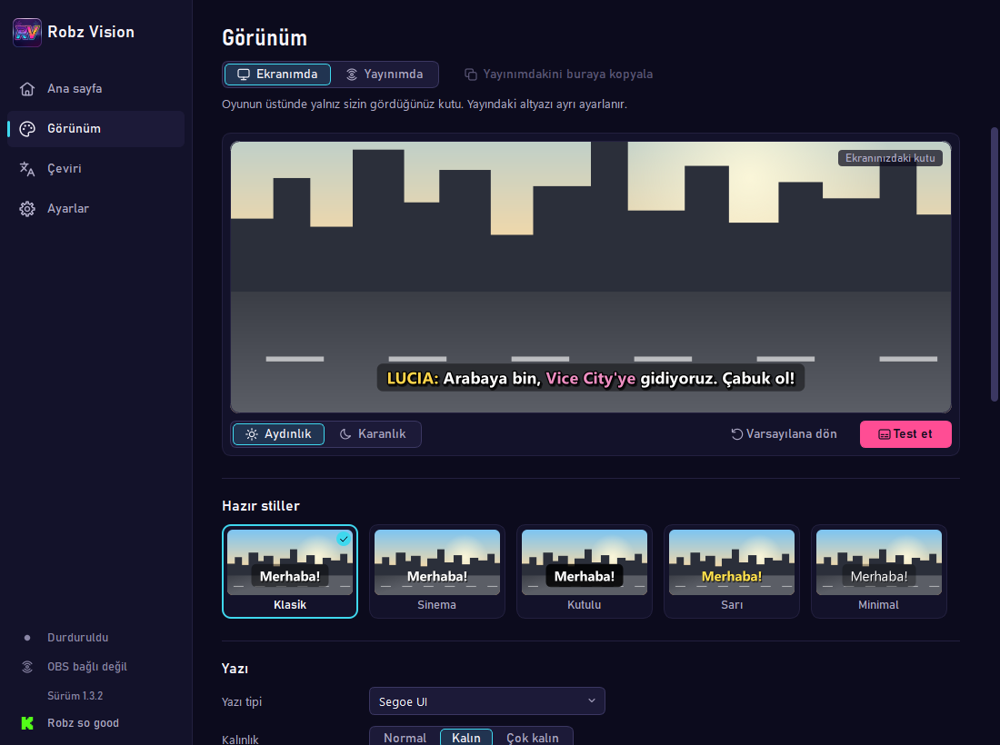<br>
      <sub><b>Görünüm:</b> Ekranımda ve Yayınımda ayrı; canlı önizleme, hazır stiller ve yazı.</sub>
    </td>
    <td width="33%" valign="top">
      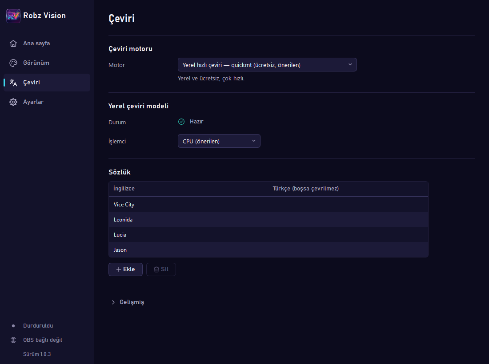<br>
      <sub><b>Çeviri:</b> motor seçimi, yerel yapay zekâyı kuran <i>Önerilen kurulum</i> ve sözlük.</sub>
    </td>
  </tr>
  <tr>
    <td colspan="3" align="center" valign="top">
      <br>
      <sub><b>Güncelleme:</b> yeni sürüm çıkınca <i>Neler yeni?</i> ve tek tıkla <b>Güncelle</b>; ayarlar ve modeller korunur.</sub>
    </td>
  </tr>
</table>
</details>

<p align="center"></p>

## Neler yapar

<table>
  <tr>
    <td width="33%" valign="top"><b>Yerel yapay zekâ çevirisi</b><br>
      Gemma 4, konuşmanın önceki 8 satırını görerek doğal Türkçe yazar, OCR'ın yanlış okuduğu harfleri düzeltir.
      Ücretsiz, internetsiz, kotasız; Robz Vision <a href="#yerel-yapay-zekâ-çevirisi-önerilen">kendisi kurar</a>.</td>
    <td width="33%" valign="top"><b>Yalnız altyazı okunur</b><br>
      Plaka, tabela, neon, duvar yazısı ve tuş ipuçları çevrilmez; yalnız altyazı biçimindeki yazı okunur.
      Bölgeyi tam ortalı seçmeniz gerekmez.</td>
    <td width="33%" valign="top"><b>Oyun altyazısının üzerine</b><br>
      İsterseniz Türkçe, İngilizcenin tam yerine yazılır: koyu kutu İngilizceyi örter, oyun Türkçe altyazılıymış
      gibi görünür.</td>
  </tr>
  <tr>
    <td valign="top"><b>Ekranınızda ve yayında</b><br>
      Taşınabilir bir ekran kutusu ve OBS Tarayıcı Kaynağı. İkisinin yeri ve görünümü ayrı; ekrandaki kutu
      varsayılan olarak yayına girmez.</td>
    <td valign="top"><b>Hızlı ve hafif</b><br>
      Altyazı ~0,1 sn'de okunur. Altyazı değişmedikçe OCR çalışmaz; yapay zekâ gecikirse önce hızlı çeviri
      görünür, yapay zekânınki gelince yerine geçer.</td>
    <td valign="top"><b>Satır kaçmaz</b><br>
      Hızlı konuşmada son çeviriler alt alta kalır. Kaçırdığınız satırı Ana sayfadaki <i>Son çeviriler</i>
      listesinden yeniden okuyup kopyalayabilirsiniz.</td>
  </tr>
  <tr>
    <td valign="top"><b>Özel isimler korunur</b><br>
      Vice City, Lucia, Jason çevrilmez, ekleri kesme işaretiyle alır: Lucia'yı, Vice City'de. Sözlüğe kendi
      karşılıklarınızı ekleyebilirsiniz.</td>
    <td valign="top"><b>Görünüm sizin</b><br>
      Beş hazır stil, yazı tipi, renk, kenar, gölge, arka plan. Oyunun pembe yazdığı yer, kişi ve eşya adları
      çeviride de renkli.</td>
    <td valign="top"><b>Ücretsiz ve gizli</b><br>
      Hesap, abonelik ya da API anahtarı yok. Varsayılan ayarlarla ekran görüntüsü, OCR ve çeviri bilgisayarınızda
      kalır.</td>
  </tr>
</table>

<details>
<summary><b>Tüm özellikler</b></summary>

- **Yerel yapay zekâ çevirisi (önerilen).** Ollama ile bilgisayarınızda çalışan Gemma 4 (`gemma4:12b`),
  konuşmanın önceki 8 satırını görerek çevirir. OCR'ın yanlış okuduğu harfleri düzeltir, tuş ipuçlarını
  ("Hold L2 to …") ayırır. Ücretsizdir; internetsiz ve kotasız çalışır. İlk açılışta *Yapay zekâ ile*'yi
  seçmeniz yeterli: Robz Vision Ollama'yı ve modeli [kendisi kurar](#yerel-yapay-zekâ-çevirisi-önerilen).
- **Her oyunda aynı, sade kurallar.** Yapay zekâ doğal ve akıcı Türkçe yazar, kelimesi kelimesine çevirmez.
  Özel isimler (Vice City, Lucia, John) Türkçedeki kural gibi çevrilmez, ekleri kesme işaretiyle alır:
  Lucia'yı, Vice City'de. Tuş adları (L2, X) olduğu gibi kalır. Oyuna özel profil ya da ek bağlam gerekmez.
- **Ücretsiz ve yerel.** OCR ve hızlı çeviri modeli (quickmt) bilgisayarınızda çalışır. Hesap, API anahtarı
  ya da abonelik gerekmez. Varsayılan ayarlarla internet yalnızca modelleri (yapay zekâyı seçerseniz Ollama'yı
  da) bir kez indirmek ve saatte bir yeni sürüm olup olmadığına bakmak için kullanılır (kapatılabilir).
- **Kendini günceller.** Yeni sürüm çıkınca uygulama haber verir; **Güncelle**'ye basınca kurulum dosyası iner,
  doğrulanır, sessizce kurulur ve Robz Vision yeniden açılır. Ayarlarınız, sözlüğünüz ve modelleriniz korunur.
- **Hızlı.** Altyazı belirdikten ~0,1 sn sonra okunur; hızlı çeviri işlemcide 20–60 ms, yapay zekâ çevirisi
  12 GB'lık ekran kartında satır başına ~0,35 sn sürer. Yapay zekâ gecikirse önce hızlı çeviri görünür, yapay
  zekânınki gelince yerine geçer.
- **Yalnız altyazıları oku** (*Ayarlar → Metin okuma*, varsayılan açık). Plaka, tabela, neon, duvar yazısı,
  köşedeki göstergeler ve tuş ipuçları gibi oyun içi yazılar çevrilmez; yalnız altyazı biçimindeki yazı (beyaz ya
  da açık gri, koyu kenarlı ya da gölgeli, ortalı) okunur. Altyazısı renkli, kenarsız ya da sola dayalı bir
  oyunda kapatın.
- **Oyun altyazısının üzerine** (*Görünüm → Yerleşim*, *Ekranımda* ve *Yayınımda* ayrı, varsayılan kapalı).
  Türkçe çeviri oyunun İngilizce altyazısının tam yerine yazılır; koyu, tamamen kapalı bir kutu İngilizceyi
  örter. Kutu her satırda altyazının yerine ve genişliğine oturur, Türkçe oyunun yazısıyla aynı boydadır; uzun
  çeviride yazı biraz küçülür, gerekirse kutu yukarı doğru büyür.
- **İki ayrı çıktı.** Kendi ekranınızda taşıyıp boyutlandırabileceğiniz bir altyazı kutusu, izleyicileriniz
  için de bir OBS Tarayıcı Kaynağı. İkisinin konumu birbirinden bağımsızdır.
- **Bölge ya da pencere.** Altyazının çıktığı alanı fareyle seçersiniz. İsterseniz belirli bir uygulama
  penceresinden okursunuz; pencere başka pencerelerin arkasında kalsa da çalışır.
- **Satır kaçmaz, takılı kalmaz.** Hızlı konuşmada son çeviriler ekranda ve OBS'te alt alta kalır. Oyunda
  sabit duran bir yazı (tuş ipucu, menü) çeviriyi ekranda tutmaz. Ana sayfadaki *Son çeviriler* listesinden
  kaçırdığınız satırı yeniden okuyup kopyalayabilirsiniz.
- **Gereksiz iş yapmaz.** Altyazı değişmedikçe OCR çalışmaz. Titreyen okumaları ayıklar, daha temiz bir okuma
  gelirse çeviriyi düzeltir. Konuşmacı adları (`LUCIA: …`) çevrilmez, ayrı renkte gösterilir.
- **Vurgulu kelimeler.** Oyun görev yazısında bir yeri, kişiyi ya da eşyayı renkli yazarsa çeviride de karşılığı
  renkli görünür. Varsayılan renk GTA 6'nın pembesidir.
- **Sözlük.** Karakter ve yer adlarını olduğu gibi bırakır ya da sizin verdiğiniz karşılığı kullanır.
- **Görünüm.** Hazır stiller (Klasik, Sinema, Kutulu, Sarı, Minimal), yazı tipi, boyut, renk, kenar, gölge ve
  arka plan. Ekranınızdaki kutu ile yayındaki altyazı ayrı ayarlanır: örneğin ekranda küçük yazı, yayında arka
  planlı büyük yazı. Canlı önizleme vardır; değişiklik anında yansır.
- **Çevrimiçi seçenekler.** Kendi anahtarınızla Google Gemini ya da DeepL. Hata ya da kota sınırında hızlı
  yerel çeviriyle devam eder.
- Global kısayollar, sistem tepsisi, çeviri önbelleği ve baştan sona Türkçe arayüz.

</details>

### Sayılarla

| ~0,1 sn | ~0,35 sn | 20–60 ms | ~0,6 çekirdek | 0 TL |
|:---:|:---:|:---:|:---:|:---:|
| altyazı belirdikten okunup çeviriye gitmesine kadar | yapay zekâ çevirisi, satır başına (12 GB ekran kartı) | hızlı yerel çeviri, işlemcide | OCR'ın okurken işlemci yükü | hesap, abonelik, API anahtarı yok |

<sub>1.3.0 ölçümleri: okuma süresi ~0,4 sn'den ~0,1 sn'ye, okurken işlemci yükü ~4 çekirdekten ~0,6 çekirdeğe indi; yazı
yokken ~0,3 çekirdek. Ayrıntılar [CHANGELOG](CHANGELOG.md)'de. Süreler donanıma göre değişir.</sub>

## 3 adımda başla

1. **İndirin ve kurun.** [Releases](https://github.com/kutsalkiremitci/robz-vision/releases/latest) sayfasından
   `RobzVision-Setup-<sürüm>-x64.exe`'yi indirip sihirbazda **İleri**'ye basın. İlk açılışta *Yapay zekâ ile*'yi
   seçin (ekran kartınız uygunsa önceden seçili gelir); ücretsiz hızlı çeviri modeli inince program açılır.
2. **Bölgeyi seçin.** Ana sayfada **Bölge seç**'e basın, altyazının çıktığı alanı fareyle çizip **Onayla**'ya basın.
   Oyun arkada akmaya devam eder.
3. **Başlatın.** **Başlat**'a basın; altyazı ekrana geldiğinde Türkçesi de gelir. Kutunun yerini
   *Ekranımda → Konumu ayarla* ile bir kez seçin. Yayıncıysanız Ana sayfadaki adresi OBS'e **Tarayıcı** kaynağı
   olarak ekleyin.

<p align="center">
  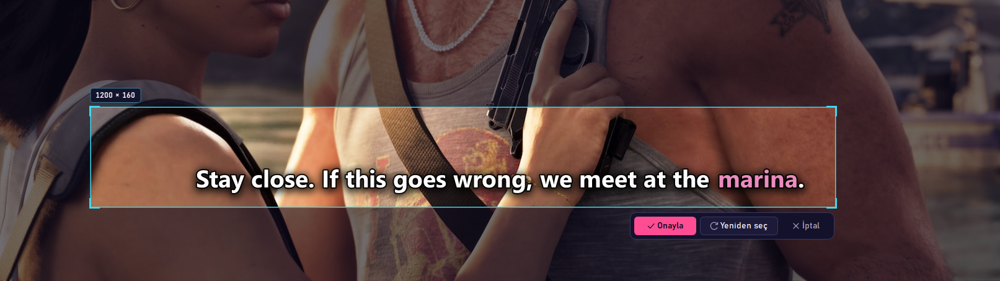
</p>

Kısayollar: `Ctrl+Alt+T` başlat/durdur, `Ctrl+Alt+H` gizle/göster, `Ctrl+Alt+C` temizle (Ayarlar sayfasından
değiştirilebilir). Adım adım anlatım, ekran görüntüleri ve senaryolara göre ipuçları:
**[docs/KULLANIM.md](docs/KULLANIM.md)**

<details>
<summary><b>İlk kullanım, adım adım</b></summary>
<br>

<p align="center">
  
</p>

1. **İlk açılış.** Program çevirinin nasıl yapılacağını sorar: *Yapay zekâ ile* ya da *Yalnız hızlı çeviri*
   ([ayrıntılar](#yerel-yapay-zekâ-çevirisi-önerilen)). Ana pencere açılınca kısa bir tur arayüzün bölümlerini
   gösterir. Atlarsanız *Ayarlar → Tanıtım turunu başlat* ile yeniden açabilirsiniz.
2. **Bölge seç.** Ana sayfada **Bölge seç**'e basın. Ekran kararır, oyun arkada akmaya devam eder.
   Altyazının çıktığı alanı fareyle çizip **Onayla**'ya basın.
3. **Başlat.** Altyazı ekrana geldiğinde Türkçesi de gelir.
4. **Ekranımda → Konumu ayarla.** Türkçe kutuyu istediğiniz yere sürükleyin, kenarlarından boyutlandırın,
   bitirmek için çift tıklayın.
   
5. **OBS (isteğe bağlı).** Ana sayfadaki adresi kopyalayın, OBS'te **Tarayıcı** kaynağı olarak ekleyin:
   *Yerel dosya* işaretsiz, genişlik ve yükseklik tuvalle aynı (ör. 1920 × 1080), kaynak oyun görüntüsünün
   üstünde.
6. **Daha iyi çeviri (önerilen).** Yalnız hızlı çeviriyle başladıysanız *Çeviri* sayfasında
   **Önerilen kurulum**'a basın; Robz Vision Ollama'yı ve Gemma 4'ü kendisi kurar:
   [Yerel yapay zekâ çevirisi](#yerel-yapay-zekâ-çevirisi-önerilen).

</details>

> [!TIP]
> **PS5'te, televizyonda ya da capture kartıyla mı oynuyorsunuz?** Hangi kabloyu nereye takacağınızdan
> çeviriyi açmaya kadar her adım çizimlerle aşağıda: [Adım adım kurulum rehberi](#adım-adım-kurulum-rehberi).

<p align="center"></p>

## Adım adım kurulum rehberi

Robz Vision'ı hiç kurmadıysanız ya da PS5'i bilgisayarda veya televizyonda Türkçe çeviriyle oynamak
istiyorsanız buradan başlayın. Her adım çizimli.

Robz Vision **bilgisayarda** çalışır ve bilgisayar ekranındaki altyazıyı okur; televizyona ya da PS5'e
kurulmaz. Konsolda oynuyorsanız oyunun görüntüsünü önce bilgisayara getirirsiniz. Türkçe çeviriyi sonra ister
monitörde ister televizyonda görürsünüz.

<p align="center">
  
</p>

| Malzeme | Ne işe yarar | Hangi yolda |
|---|---|---|
| **Windows bilgisayar ve monitör** | Robz Vision bunda çalışır: Windows 10 (2004 ve sonrası) ya da Windows 11, 64 bit. Ekran kartı gerekmez; yerel yapay zekâ çevirisi için en az 8 GB bellekli NVIDIA ya da AMD kart gerekir ([Sistem gereksinimleri](#sistem-gereksinimleri)). | Hepsi |
| **PS5 ve DualSense** | Oyun PS5'te çalışır, görüntüsü bilgisayara gelir. | 2, 3, 4 |
| **USB-C kablo** | DualSense'i bilgisayara bağlar. PS5'in kutusundan çıkan şarj kablosu olur. Kablo yerine Bluetooth da olur. | 2, 3 |
| **Modem ve Ethernet kablosu** | PS5 ile bilgisayar aynı modeme bağlı olmalı. PS5'i modeme kabloyla bağlamanızı öneririz: görüntü netleşir, okuma iyileşir. | 2, 3 |
| **HDMI kablo ve televizyon** | Bilgisayarı TV'ye bağlar; TV bilgisayarın ekranı olur. Marka fark etmez, HDMI girişi yeter. | 3 (4'te isteğe bağlı) |
| **Capture kartı** (isteğe bağlı) | PS5'in HDMI görüntüsünü USB ile bilgisayara aktarır. En net görüntü bu yolda; OBS ile kullanılır. | 4 |

### 1. Robz Vision'ı kurun

<p align="center">
  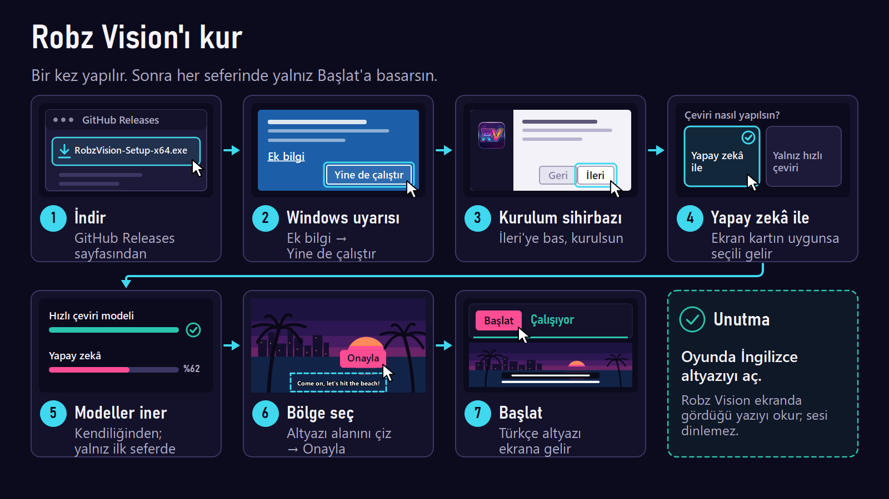
</p>

1. **İndirin.** [Releases](https://github.com/kutsalkiremitci/robz-vision/releases/latest) sayfasında
   `RobzVision-Setup-<sürüm>-x64.exe` dosyasını indirin.
2. **Çalıştırın.** Windows "bilinmeyen yayımcı" uyarısı (SmartScreen) verirse *Ek bilgi*'ye, sonra
   **Yine de çalıştır**'a basın. Kurulum dosyası dijital olarak imzalı olmadığı için bu uyarı çıkar; dosyayı
   yalnızca bu deponun Releases sayfasından indirin.
3. **Kurun.** Sihirbazda **İleri**'ye basın. Yönetici izni istemez.
4. **İlk açılış.** *Çeviri nasıl yapılsın?* sorusunda *Yapay zekâ ile*'yi seçip **Devam**'a, sonra **Kur**'a
   basın. Ekran kartınız uygunsa bu seçenek önceden seçili gelir; uygun kart yoksa *Yalnız hızlı çeviri* ile
   başlayın.
5. **Modeller iner.** Hızlı çeviri modeli (404 MB) inince **Şimdi başla**'ya basın. Yapay zekâ (yaklaşık
   10 GB) arka planda iner, hazır olunca kendiliğinden devreye girer.

Çizimdeki son üç adımı (**Bölge seç**, **Onayla**, **Başlat**) oyunun görüntüsü ekrandayken yaparsınız;
yolunuzun adımlarında anlatılıyor. Kurulumun ayrıntıları: [Kurulum](#kurulum).

### 2. Yolunuzu seçin

<p align="center">
  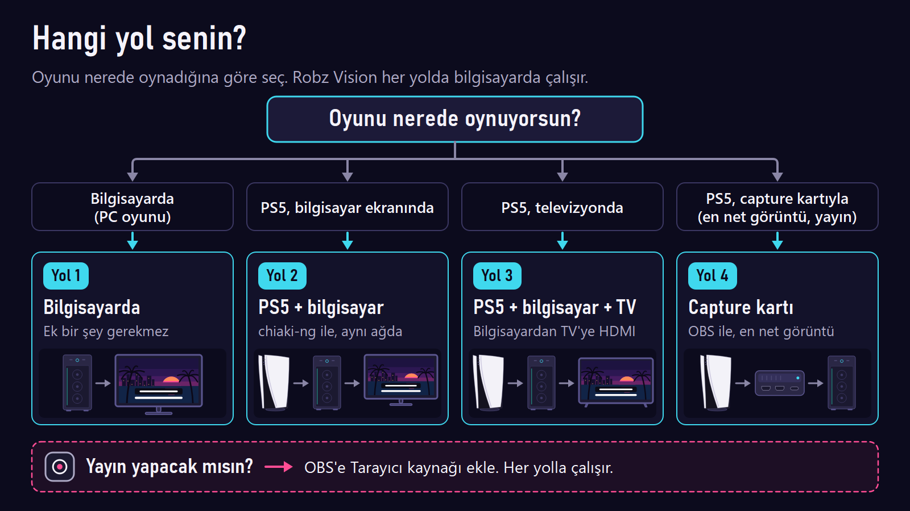
</p>

| | Kimin için | Ne gerekir |
|---|---|---|
| **[Yol 1](#yol-1-bilgisayarda-oynuyorum)** | Oyunu bilgisayarda oynayanlar | Yalnız bilgisayar |
| **[Yol 2](#yol-2-ps5i-bilgisayar-ekranında-oynuyorum)** | PS5'i bilgisayarın ekranında oynamak isteyenler | PS5, DualSense, USB-C kablo, ücretsiz chiaki-ng programı; Ethernet kablosu önerilir |
| **[Yol 3](#yol-3-ps5i-televizyonda-oynuyorum)** | PS5'i televizyonda oynamak isteyenler, TV'nin markası ne olursa olsun | Yol 2'dekiler, HDMI kablo |
| **[Yol 4](#yol-4-capture-kartıyla-oynuyorum)** | Capture kartı olanlar; en net görüntü | Capture kartı, HDMI kablolar, OBS |

Yayın yapacaksanız yolunuzu kurduktan sonra [3. adıma](#3-yayın-yapacaksanız) geçin. Xbox'ta Yol 2 ve 3'ü
chiaki-ng yerine Xbox uygulamasıyla yaparsınız.

#### Yol 1: Bilgisayarda oynuyorum

Oyun bilgisayarda çalışıyor ve ekranda İngilizce altyazı var. Ek kablo ya da program gerekmez.

<details>
<summary><b>Yol 1: çizim ve adımlar</b></summary>
<br>

<p align="center">
  
</p>

1. **Oyunu hazırlayın.** Oyunun ayarlarında İngilizce altyazıyı açın. Oyunu *Pencereli tam ekran*
   (kenarlıksız) modunda çalıştırın; bazı oyunlar özel tam ekran modunda Türkçe kutuyu üstte göstermez.
2. **Bölgeyi seçin.** Robz Vision'ın Ana sayfasında *Çevrilecek bölge* altında **Ekran bölgesi** seçili olsun.
   **Bölge seç**'e basın, altyazının çıktığı alanı fareyle çizip **Onayla**'ya basın. Oyun arkada akmaya
   devam eder.
3. **Başlatın.** **Başlat**'a basın. Oyunda altyazı belirince Türkçesi kutuda görünür.
4. **Kutuyu yerleştirin.** *Ekranımda → Konumu ayarla* ile kutuyu İngilizce altyazının hemen üstüne
   sürükleyin; bitirmek için çift tıklayın.

Oyun sırasında `Ctrl+Alt+H` çeviriyi gizler ve gösterir. GTA VI gibi konsol oyunları için Yol 2, 3 ya da 4'ü
seçin.

</details>

#### Yol 2: PS5'i bilgisayar ekranında oynuyorum

PS5 yerinde kalır; görüntüsü ev ağı üzerinden bilgisayara gelir, oyunu bilgisayardan oynarsınız. Bunun için
ücretsiz ve açık kaynak uzaktan oynatma programı **chiaki-ng**'i öneriyoruz; Sony'nin resmî PS Remote Play
uygulaması da çalışır.

<details>
<summary><b>Yol 2: çizim ve adımlar</b></summary>
<br>

<p align="center">
  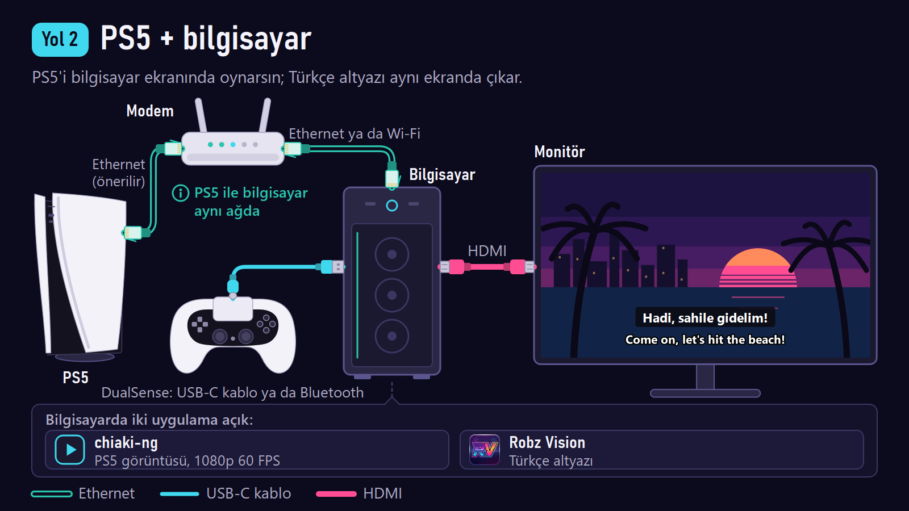
</p>

**PS5'te (bir kez)**

1. **Kabloları takın.** PS5'i Ethernet kablosuyla modeme bağlayın (önerilir; Wi-Fi'da da çalışır ama görüntü
   daha çok bozulabilir). Bilgisayar da aynı modeme bağlı olsun, kabloyla ya da Wi-Fi ile.
2. **Uzaktan Oynama'yı açın.** PS5'te *Ayarlar > Sistem > Uzaktan Oynama > Uzaktan Oynama'yı Etkinleştir*.
3. **Dinlenme modundan uyansın (isteğe bağlı).** *Ayarlar > Sistem > Güç Tasarrufu > Dinlenme Modunda
   Kullanılabilen Özellikler*'de *İnternete Bağlı Kalın*'ı ve *PS5 Sisteminin Ağdan Açılmasını Etkinleştir*'i
   açın. Böylece dinlenme modundaki PS5'i bilgisayardan açabilirsiniz.

**chiaki-ng'de (bir kez)**

4. **chiaki-ng'i kurun.** [chiaki-ng'in GitHub sürüm sayfasından](https://github.com/chiaki-ng/chiaki-ng/releases/latest)
   `chiaki-ng-win_x64-MSYS2-installer.exe` dosyasını indirip kurun ya da komut isteminde
   `winget install --id=StreetPea.chiaki-ng -e` yazın. Yalnız bu resmî kaynaklardan indirin; chiaki-ng adını
   taşıyan başka siteler projenin değildir.
5. **PSN'e giriş yapın.** PS5 açık ya da dinlenme modunda olsun. chiaki-ng'i açın; PS5 aynı ağdaysa listede
   kendiliğinden görünür. chiaki-ng PlayStation Network'e giriş ister: açılan sayfada hesabınızla giriş yapın
   ve ekrandaki yönergeye uyun (chiaki-ng, tarayıcıdaki adresi kopyalayıp yapıştırmanızı isteyebilir). Bunu
   bir kez yaparsınız.
6. **PS5'i kaydedin.** Listede PS5'in altında *Automatic Registration Available* yazar: PS5'e tıklayıp
   onaylayın, kod gerekmez. Bu yazı çıkmazsa PS5'te *Ayarlar > Sistem > Uzaktan Oynama > Cihazı Eşleştir*'i
   seçin; ekranda bir sayı çıkar. chiaki-ng'de PS5'e tıklayın, sayıyı *Remote Play PIN* alanına yazıp
   *Register*'a basın.
7. **Görüntüyü 1080p 60 FPS yapın.** Sağ üstteki dişliye basın; *Stream Settings* sekmesinde çözünürlüğü
   *1080p*, kare hızını *60 fps* seçin. Altyazı ne kadar net olursa Robz Vision o kadar iyi okur. Görüntü
   takılıyorsa 720p'ye inin.
8. **Kolu bağlayın.** DualSense'i USB-C kabloyla (PS5'in kutusundan çıkan şarj kablosu) bilgisayara takın.
   Kablosuz isterseniz Bluetooth ile eşleştirin: kolun **Oluştur** düğmesini basılı tutarken ışıklı çubuk
   yanıp sönene kadar **PS** düğmesini basılı tutun, sonra Windows'un Bluetooth ayarlarında kolu listeden
   seçin. Kolu yeniden PS5'te kullanmak için USB kabloyla PS5'e takıp PS düğmesine basın.

**Her oynayışta**

9. **PS5'e bağlanın.** chiaki-ng'de PS5'e tıklayın; PS5'in görüntüsü bir pencerede açılır. Pencereyi büyütün
   ya da tam ekran yapın. Oyunda İngilizce altyazıyı açın.
10. **Robz Vision'da pencereyi seçin.** Ana sayfada *Çevrilecek bölge* altında **Uygulama penceresi**'ni
    seçin, listeden chiaki-ng'in oyun penceresini seçin. **Bölge seç**'e basıp altyazının çıktığı alanı
    çizin, **Onayla**'ya basın. Pencere başka pencerelerin arkasında kalsa da okunur, ama simge durumuna
    küçültülmemeli. chiaki-ng tam ekransa **Ekran bölgesi** de olur.
11. **Başlatın ve kutuyu yerleştirin.** **Başlat**'a basın. *Ekranımda → Konumu ayarla* ile Türkçe kutuyu
    İngilizce altyazının hemen üstüne sürükleyin; bitirmek için çift tıklayın.

PS Remote Play kullanacaksanız 4–7. adımlar yerine onu kurun; Robz Vision'da onun penceresini seçersiniz.
chiaki-ng'de çözünürlüğü, kare hızını ve görüntü ayarlarını elle seçebilirsiniz; altyazı net gelirse okuma
iyileşir.

</details>

#### Yol 3: PS5'i televizyonda oynuyorum

Yol 2'nin aynısı; tek fark, bilgisayar HDMI kablosuyla televizyona bağlanır ve TV bilgisayarın ekranı olur.
Robz Vision TV'de değil bilgisayarda çalışır; Türkçe kutu TV'de oyunun üstünde görünür. TV'nin markası fark
etmez, HDMI girişi olması yeter.

<details>
<summary><b>Yol 3: çizim ve adımlar</b></summary>
<br>

<p align="center">
  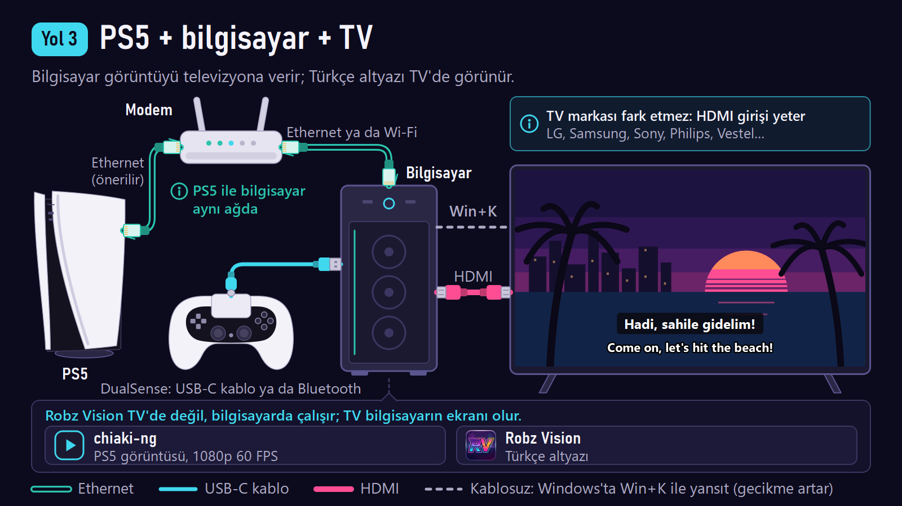
</p>

1. **PS5'i ve chiaki-ng'i hazırlayın.** [Yol 2](#yol-2-ps5i-bilgisayar-ekranında-oynuyorum)'nin 1–8.
   adımlarını yapın.
2. **Bilgisayarı TV'ye bağlayın.** HDMI kablonun bir ucunu bilgisayarın HDMI çıkışına (masaüstü bilgisayarda
   ekran kartının üstündeki çıkışa), öbür ucunu TV'nin HDMI girişine takın.
3. **TV'de girişi seçin.** Kumandadaki *Kaynak*, *Source* ya da *Input* düğmesiyle kabloyu taktığınız HDMI
   girişini seçin.
4. **Windows'ta ekranı seçin.** *Win+P*'ye basın: *Yalnızca ikinci ekran* görüntüyü yalnız TV'ye verir,
   *Çoğalt* monitörde ve TV'de aynı görüntüyü gösterir.
5. **Oyun modunu açın.** TV'nin görüntü ayarlarında *Oyun modu*nu açarsanız gecikme azalır. Adı ve yeri
   markaya göre değişir.
6. **Oynayın.** chiaki-ng'de PS5'e bağlanıp pencereyi TV'de tam ekran yapın. Robz Vision'da pencereyi ya da
   bölgeyi seçip **Başlat**'a basın, Türkçe kutuyu yerleştirin (Yol 2'nin 9–11. adımları).

**Monitör de açık kalsın isterseniz** *Win+P*'de *Genişlet*'i seçin: chiaki-ng penceresini TV'ye taşıyın,
Robz Vision monitörde kalsın. Bölge seçici bütün ekranlarda açılır. Türkçe kutuyu *Ekranımda → Konumu ayarla*
ile TV ekranına sürükleyin.

**Kablo yerine kablosuz.** TV'niz kablosuz ekran yansıtmayı (Miracast) destekliyorsa bilgisayarda *Win+K*'ye
basıp listeden TV'yi seçin (LG'de *Screen Share*). Gecikme artar; hikâye oyunlarında genelde sorun olmaz.
Türkçe kutu TV'de görünmezse Ana sayfada **Yayında da görünsün**'ü açın; kutu okunan bölgenin üstüne gelirse
Robz Vision uyarır, kutuyu biraz kaydırın.

</details>

#### Yol 4: Capture kartıyla oynuyorum

PS5'in görüntüsü HDMI kablosuyla capture kartına, karttan USB ile bilgisayara gider. Uzaktan oynatma
sıkıştırması olmadığı için altyazı en net bu yolda okunur. Kol PS5'e her zamanki gibi bağlı kalır.

<details>
<summary><b>Yol 4: çizim ve adımlar</b></summary>
<br>

<p align="center">
  
</p>

1. **HDCP'yi kapatın.** PS5'te *Ayarlar → Sistem → HDMI → HDCP'yi Etkinleştir* kapalı olmalı; açıkken kart
   görüntüyü alamaz.
2. **Kabloları takın.** PS5'in HDMI çıkışını capture kartının HDMI girişine, kartı USB ile bilgisayara takın.
   TV ya da monitör bilgisayara HDMI ile bağlı kalır.
3. **Görüntüyü bir pencerede açın.** Capture kartını OBS'e kaynak olarak ekleyin. Kaynağa sağ tıklayıp
   **Pencereli Projektör (Kaynak)**'ı açın; bu pencere yalnız oyun görüntüsünü gösterir. Oyunu bu pencereden
   oynarsınız; pencereyi TV'de ya da monitörde büyütebilirsiniz. Kartın kendi önizleme uygulaması da olur.
4. **Robz Vision'da pencereyi seçin.** *Çevrilecek bölge* altında **Uygulama penceresi** ile projektör
   penceresini seçin; **Bölge seç** ile altyazı alanını çizip **Onayla**'ya basın. Robz Vision'ın OBS
   önizlemesini değil bu pencereyi okuması gerekir: önizlemede Türkçe altyazı da vardır. Projektör penceresi
   başka pencerelerin arkasında kalabilir, ama simge durumuna küçültülmemeli.
5. **Başlatın ve kutuyu yerleştirin.** **Başlat**'a basın; *Ekranımda → Konumu ayarla* ile kutuyu
   yerleştirin.

**Kartın kendi HDMI çıkışı (passthrough).** Bazı kartların TV'ye giden düşük gecikmeli bir çıkışı vardır. Bu
görüntü bilgisayardan geçmez, orada çeviri görünmez. O çıkıştan oynuyorsanız Türkçeyi bilgisayarın ekranında
okursunuz: Türkçe kutuda ya da OBS önizlemesinde (Tarayıcı kaynağını eklediyseniz). Yalnız OBS önizlemesine
bakacaksanız ekrandaki kutuyu kapatabilirsiniz (**Ekranımda → Kapalı**).

</details>

### 3. Yayın yapacaksanız

<p align="center">
  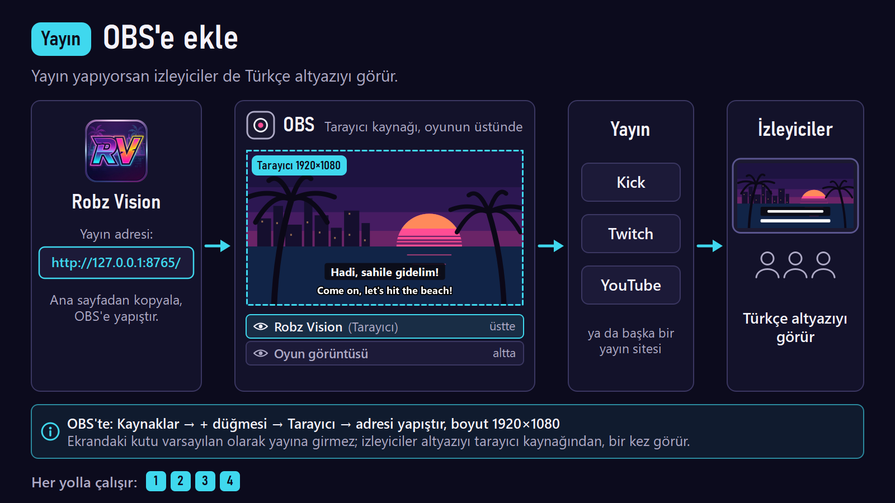
</p>

İzleyicilerinizin de Türkçe görmesi için Robz Vision'ın adresini OBS'e ekleyin. İzleyiciler hiçbir şey
kurmaz.

1. **Adresi kopyalayın.** Robz Vision'ın Ana sayfasındaki **OBS** bölümünde bir adres yazar (varsayılan
   `http://127.0.0.1:8765/`); kopyalayın.
2. **OBS'e ekleyin.** OBS'te *Kaynaklar* altındaki **+**'ya basıp **Tarayıcı**'yı seçin. *Yerel dosya*
   işaretsiz kalsın, *URL*'ye adresi yapıştırın, genişlik ve yüksekliği tuvalle aynı yapın (ör. 1920 × 1080).
3. **Üste taşıyın.** Kaynağı listede oyun görüntüsünün (oyun, chiaki-ng penceresi ya da capture kartı) üstüne
   taşıyın.
4. **Yayına çıkın.** Kick, Twitch ya da YouTube'a her zamanki gibi yayın açın; izleyiciler Türkçe altyazıyı
   görür.

Ekrandaki Türkçe kutu varsayılan olarak yayına girmez; izleyiciler altyazıyı iki kez görmez. İngilizce altyazıyı
yayında örtmek için *Görünüm → Yayınımda → Gelişmiş ayarlar → OBS'te orijinali kapat*'ı açın. Ayrıntılar:
[kullanım kılavuzu, OBS'e ekleyin](docs/KULLANIM.md#5-obse-ekleyin).

### Takılırsanız

- **chiaki-ng PS5'i bulmuyor.** PS5 açık ya da dinlenme modunda olmalı; PS5 ve bilgisayar aynı modeme bağlı
  olmalı. *Automatic Registration Available* çıkmıyorsa PS5'teki *Cihazı Eşleştir* koduyla kaydedin
  ([Yol 2](#yol-2-ps5i-bilgisayar-ekranında-oynuyorum), 6. adım).
- **chiaki-ng'in penceresi boş kalıyor ya da program açılmıyor.** Başlat menüsünden *chiaki-ng (OpenGL)*'i
  açın.
- **TV'de görüntü yok.** Kumandada *Kaynak*, *Source* ya da *Input* ile kabloyu taktığınız HDMI girişini
  seçin. Bilgisayarda *Win+P* ile *Yalnızca ikinci ekran*'ı ya da *Çoğalt*'ı seçin.
- **Türkçe kutu TV'de görünmüyor.** *Ekranımda* *Açık* olmalı. Kutuyu *Konumu ayarla* ile TV ekranına
  sürükleyin. Kablosuz yansıtmada **Yayında da görünsün**'ü açın.
- **Altyazı okunmuyor ya da yanlış okunuyor.** PS5'i modeme kabloyla bağlayın, chiaki-ng'de 1080p ve 60 fps
  seçin, oyunda altyazıyı büyütün. Bölgeyi yalnız altyazı satırlarını kapsayacak kadar daraltın.
- **Capture kartından görüntü gelmiyor.** PS5'te HDCP kapalı olmalı ([Yol 4](#yol-4-capture-kartıyla-oynuyorum)).

Daha fazla çözüm: [SSS ve sorun giderme](#sss-ve-sorun-giderme) ·
[kullanım kılavuzu, Sorun giderme](docs/KULLANIM.md#10-sorun-giderme).

<p align="center"></p>

## Kimin için?

Robz Vision **bilgisayar ekranındaki** altyazıyı okur.

| | Nasıl kullanır | Nereye bakar |
|---|---|---|
| **Bilgisayarda oynayan** | PC'deki İngilizce altyazılı oyun. Altyazının çıktığı alanı bir kez seçer, Başlat'a basar. OBS gerekmez. | Oyun ekranına. Türkçe kutu oyunun üstünde, istediği yerde durur. |
| **Konsolda oynayan** (PS5, Xbox) | Konsolu chiaki-ng, PS Remote Play ya da Xbox uygulamasıyla bilgisayardan oynatır ya da capture kartının görüntüsünü bir pencerede açar. GTA VI gibi konsol oyunları için yol bu: [Yolunuzu seçin](#2-yolunuzu-seçin). | Bilgisayar ekranındaki oyuna; bilgisayar TV'ye bağlıysa TV'ye. |
| **Yayıncı** (Kick, Twitch, YouTube) | Ana sayfadaki adresi OBS'e Tarayıcı Kaynağı olarak ekler. İsterse İngilizce altyazının üstünü kapatır. | Kendi ekranındaki kutuya; izleyiciler OBS'teki altyazıyı görür. Ekrandaki kutu varsayılan olarak yayına girmez. |
| **İzleyici** | Hiçbir şey kurmaz. Altyazının görünümünü yayıncı Görünüm sayfasından ayarlar. | Yayına. |

> [!IMPORTANT]
> **Televizyonda çalışmaz.** Konsolu doğrudan televizyona bağlayıp oynuyorsanız Robz Vision görüntüyü göremez.
> Oyunun görüntüsü bilgisayar ekranında olmalı: chiaki-ng, PS Remote Play, Xbox uygulaması ya da bir capture
> kartının önizleme penceresi. Araya bilgisayar koyarsanız çeviri TV'de de görünür:
> [Yol 3](#yol-3-ps5i-televizyonda-oynuyorum).

<details>
<summary><b>Televizyonda oynuyorsanız</b></summary>

Robz Vision televizyonun kendisinde çalışamaz: TV uygulamaları HDMI'dan gelen konsol görüntüsünü okuyamaz.
Araya bir bilgisayar koyarak çeviriyi yine de TV ekranında görebilirsiniz:

- **Bilgisayarı TV'ye HDMI ile bağlayın (en kolayı).** TV bilgisayarın ekranı olur, konsol yerinde kalır:
  [Yol 3](#yol-3-ps5i-televizyonda-oynuyorum).
- **Kablosuz yansıtın.** Aynı kurulum, kablo yerine *Win+K*; gecikme artar. Yol 3'ün sonundaki nota bakın.
- **Capture kartı kullanın (en net görüntü).** Konsol → capture kartı → bilgisayar → TV:
  [Yol 4](#yol-4-capture-kartıyla-oynuyorum).

</details>

## Neden?

Rockstar Games, GTA VI'yı Türkçe altyazı ve Türkçe seslendirme olmadan çıkarıyor: oyunun metin dilleri
arasında Türkçe yok, seslendirmesi yalnızca İngilizce.[^diller] Türkiye'deki oyuncular da hikâyeyi anlayarak
oynayabilsin istedik.

Robz Vision'ı bu yüzden aceleyle, bir iki günde yazdık. Elimizden geleni yaptık; eksikleri olabilir.
Ücretsiz, açık kaynak ve kurcalamadan kullanılabilecek kadar basit olsun istedik.

GTA VI çıkış noktamız ama sınırımız değil: Robz Vision ekranda İngilizce altyazı gösteren her oyunla çalışır.
PC oyunları, PS Remote Play ve Xbox uygulaması gibi uzaktan oynatma pencereleri, emülatörler ve capture kartı
önizlemeleri de buna dahil.

<p align="center"></p>

## Kurulum

**Kurulum dosyası (önerilen).** [Releases](https://github.com/kutsalkiremitci/robz-vision/releases/latest)
sayfasından `RobzVision-Setup-<sürüm>-x64.exe` dosyasını indirip çalıştırın ve sihirbazda **İleri**'ye
basarak kurun. Yönetici izni istemez; program kendi kullanıcı klasörünüze kurulur, Başlat menüsüne eklenir ve
*Ayarlar → Uygulamalar*'dan kaldırılabilir. İlk açılışta program çevirinin nasıl yapılacağını sorar:
*Yapay zekâ ile* ya da *Yalnız hızlı çeviri*. Ücretsiz hızlı çeviri modeli (404 MB) her durumda bir kez
indirilir; indirme bitince program açılır. Ayrıntılar:
[Yerel yapay zekâ çevirisi](#yerel-yapay-zekâ-çevirisi-önerilen).

**Taşınabilir sürüm.** `RobzVision-Portable-<sürüm>-x64.zip` (ya da daha küçük `.7z`) dosyasını kısa bir
klasöre (ör. `C:\RobzVision`) çıkarıp `RobzVision.exe`'yi çalıştırın. İndirilen dosyayı doğrulamak için
sürüm sayfasında `SHA256SUMS.txt` vardır.

**ARM işlemcili bilgisayarlar.** Ayrı bir ARM64 sürümü yok; çeviri motorunun (CTranslate2) ve birkaç
kütüphanenin ARM64 Windows paketi bulunmuyor. Windows 11 x64 programları öykünmeyle çalıştırabildiği için
kurulum dosyası ARM'li Windows 11'e de kurulur (henüz ARM cihazda denenmedi).

**Kaynak koddan.** [Python 3.12](https://www.python.org/downloads/) kurun ("Add python.exe to PATH"
işaretli). Depoyu indirip `kurulum.bat`'ı, ardından `baslat.bat`'ı çalıştırın.

**Windows "bilinmeyen yayımcı" uyarısı.** Kurulum dosyası dijital olarak imzalı değil. SmartScreen uyarısında
*Ek bilgi → Yine de çalıştır*'ı seçebilirsiniz. Dosyayı yalnızca bu deponun Releases sayfasından indirin.

### Yerel yapay zekâ çevirisi (önerilen)

Robz Vision hızlı yerel çeviriyle her bilgisayarda çalışır. Daha doğal çeviri için yerel yapay zekâyı kurun:
Ollama ve Gemma 4. Ücretsizdir; internetsiz ve kotasız çalışır. Ollama'yı ayrıca kurmanız gerekmez, Robz
Vision kendisi kurar.

1. İlk açılışta **Çeviri nasıl yapılsın?** sorusunda *Yapay zekâ ile*'yi seçip **Devam**'a basın. Ekran
   kartınız uygunsa bu seçenek önceden seçili gelir.
2. İndirilecekleri ve boş disk alanını gösteren ekranda **Kur**'a basın. Kur'a basmadan yapay zekâ için
   hiçbir şey inmez.
3. Hızlı çeviri modeli inince **Şimdi başla**'ya basın. Yapay zekâ arka planda iner, hazır olunca devreye
   girer. Çeviri çalışırken indirme durur, durdurunca kaldığı yerden sürer.

İlk açılışta *Yalnız hızlı çeviri*'yi seçtiyseniz ya da önceki bir sürümden güncellediyseniz *Çeviri*
sayfasında **Önerilen kurulum**'a basın; aynı kurulum başlar.

<details>
<summary><b>Boyutlar, gerekenler, güvenlik ve Ollama'nın güncellemeleri</b></summary>

**Boyutlar.** Hızlı çeviri modeli 404 MB, her durumda iner. Yapay zekâ yaklaşık 10 GB daha: Ollama 1,9 GB ve
Gemma 4 12B 8,0 GB. 8 GB bellekli ekran kartında 12B yerine daha hafif Gemma 4 E4B (6,6 GB) iner. Kurulum
sırasında yaklaşık 15 GB boş disk alanı gerekir.

**Gerekenler.** Windows 10 22H2 ya da Windows 11 ve en az 8 GB belleği olan bir NVIDIA ya da AMD ekran
kartı. Gemma 4 12B, 12 GB bellekli kartta rahat çalışır; satır başına yaklaşık 0,35 sn sürer.

**Güvenlik.** Ollama'nın resmî kurulum dosyası GitHub'daki sürüm sayfasından iner; sürümü sabittir. Robz
Vision dosyayı çalıştırmadan önce SHA256 özetini ve dijital imzasını (Ollama Inc.) denetler; tutmazsa siler ve
kurmaz. Kurulum sessizdir ve yönetici izni istemez. Ollama ekran kartınızı kullanamıyorsa model indirilmez.

**Ollama ayrı bir programdır.** Windows açılınca arka planda başlar; kapalıysa Robz Vision onu kendisi
başlatır. Ollama kendini de günceller: yeni sürümü (yaklaşık 1,9 GB) arka planda indirir, Windows açılışında
ya da görev çubuğundaki simgesinden *Restart to update* ile kurar. İndirmeyi istemiyorsanız Ollama'nın
ayarlarında *Auto-download updates*'i kapatın. Robz Vision'ı kaldırınca Ollama kalır.

</details>

Ayrıntılar: [kullanım kılavuzu](docs/KULLANIM.md#7-çeviriyi-iyileştirin). Kurulum yapılamazsa:
[Yapay zekâ kurulumu sorunları](docs/KULLANIM.md#yapay-zekâ-kurulumu).

## Sistem gereksinimleri

| | Robz Vision | Yerel yapay zekâ çevirisi için ayrıca |
|---|---|---|
| **Windows** | Windows 10 (2004 ve sonrası) ya da Windows 11, 64 bit; ARM'li Windows 11 öykünmeyle | Windows 10 22H2 ya da Windows 11 |
| **Ekran kartı** | Gerekmez | En az 8 GB bellekli NVIDIA ya da AMD kart; 12 GB'ta `gemma4:12b`, 8 GB'ta `gemma4:e4b` |
| **Disk** | Hızlı çeviri modeli için 404 MB | Yaklaşık 10 GB (Ollama 1,9 GB + Gemma 4 12B 8,0 GB); kurulum sırasında ~15 GB boş alan |
| **İnternet** | İlk açılışta modeli bir kez indirmek için; saatte bir sürüm denetimi (kapatılabilir) | Ollama'yı ve modeli bir kez indirmek için; çeviri sonra internetsiz |
| **Dil paketi** | Gerekmez | Gerekmez |

Yalnızca *Ayarlar → Metin okuma*'da Windows OCR'ı seçerseniz Windows'un **İngilizce OCR dil paketi** gerekir.
Yoksa *Ayarlar → Saat ve dil → Dil ve bölge → English (United States)* ekleyin ya da yönetici PowerShell'de
şunu çalıştırın:

```powershell
Add-WindowsCapability -Online -Name "Language.OCR~~~en-US~0.0.1.0"
```

## Çeviri motorları

| Motor | Maliyet | Yaklaşık süre | Gereken |
|---|---|---|---|
| **Hızlı yerel çeviri, quickmt** (varsayılan) | Ücretsiz | 20–60 ms | Hiçbir şey |
| **Yerel yapay zekâ: Ollama + Gemma 4** (önerilen) | Ücretsiz, internetsiz, kotasız | ~0,35 sn (12 GB kartta) | Ollama ve Gemma 4 (Robz Vision kurar, ~10 GB); 12 GB ekran kartında `gemma4:12b`, 8 GB'ta `gemma4:e4b` |
| **Google Gemini** | Ücretsiz katman, kotalı | 0,3–0,8 sn | Kendi API anahtarınız |
| **DeepL API Free** | Ayda 500 bin karaktere kadar ücretsiz | ~0,3 sn | Kendi API anahtarınız |

Süreler donanıma ve bağlantıya göre değişir.

- **Yerel yapay zekâ** önceki 8 satırı görür: konuşmanın gidişatına göre çevirir, OCR'ın yanlış okuduğu
  harfleri düzeltir, tuş ipuçlarını ayırır. Ollama'daki başka modeller de seçilebilir. TranslateGemma artık
  önerilmiyor: önceki satırları (bağlamı) kullanmıyor.
- **Ollama, Gemini ve DeepL'de** çeviri yaklaşık 1,2 sn içinde gelirse yalnız o görünür. Gecikirse önce
  hızlı yerel çeviri görünür, asıl çeviri gelince yerine geçer. Hata ya da kota sınırında hızlı yerel
  çeviriyle devam eder.
- **Gemini'de** önerilen model Gemini 3.5 Flash-Lite. Daha güçlü Flash modellerinin ücretsiz kotası canlı
  yayında birkaç dakikada dolar; ücretsiz katmanın sınırları
  [Google AI Studio](https://aistudio.google.com/rate-limit)'da görülür.

Ticari olmayan lisanslı modeller (ör. NLLB) para kazanılan yayınlarla çeliştiği için kullanılmadı.

## Nasıl çalışır

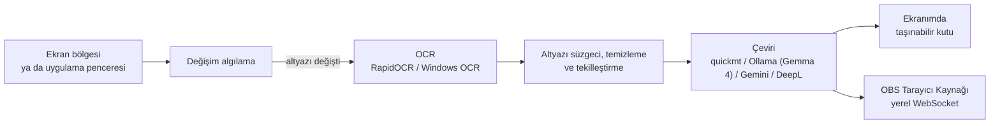

Robz Vision oyuna kod eklemez, belleğini ya da dosyalarını okumaz; yalnızca ekranda görüneni okur.

<details>
<summary><b>Adım adım</b></summary>

1. **Yakalama.** Seçtiğiniz bölge saniyede 20 kez yakalanır. Pencere modunda Windows Graphics Capture
   kullanılır; yeni kare gelmedikçe işlem yapılmaz.
2. **Değişim algılama.** Görüntü küçültülür ve ince, parlak harf çizgilerinden bir "metin maskesi" çıkarılır.
   Maske belirgin biçimde değişince yazı belirdiği karede okunur. Ekranda aynı altyazı durdukça işlemci boşta
   kalır.
3. **OCR.** Varsayılan motor RapidOCR (PP-OCRv6, ONNX); işlemcinin tamamını değil birkaç çekirdeğini kullanır.
   Kare önce ham hâliyle okunur; okuma zayıfsa asfalt/kum ayıklanmış hâliyle de okunur, daha çok bilinen
   İngilizce kelime çıkan seçilir. Windows'un yerleşik OCR'ı da seçilebilir (Windows'un İngilizce OCR dil
   paketini ister).
4. **Süzgeç ve temizleme.** *Yalnız altyazıları oku* açıkken yalnız altyazı biçimindeki yazı (beyaz ya da açık
   gri, koyu kenarlı ya da gölgeli, ortalı) kalır; Robz Vision altyazının yerini ve boyunu okuduğu altyazılardan
   öğrenir. Satırlar birleştirilir, konuşmacı adı ayrılır. Okuma, İngilizce kelime listesine göre puanlanır;
   bozuk okumalar elenir. Aynı cümle ikinci kez çevrilmez, önbellekten gelir.
5. **Çeviri.** Varsayılan model [quickmt-en-tr](https://huggingface.co/quickmt/quickmt-en-tr)'dir ve
   CTranslate2 ile işlemcide çalışır. Önerilen yerel yapay zekâ (Ollama ile Gemma 4) her satırı önceki 8
   satırla birlikte çevirir. Çevirisi yaklaşık 1,2 sn içinde gelirse yalnız o görünür; gecikirse önce
   quickmt'nin çevirisi görünür, yapay zekânınki gelince aynı satırın üstüne yazılır. Yakalama, OCR ve çeviri
   ayrı iş parçacıklarındadır ve satırları sırayla işler; hızlı konuşmada satır kaybolmaz.
6. **Gösterim.** Ekrandaki kutu ve OBS sayfası aynı zamanlayıcıya bağlıdır; birlikte belirir, birlikte
   kaybolur. Kısa süren bir altyazının çevirisi okunabilecek kadar ekranda kalır. Her satır en fazla
   *En uzun kalma* süresi kadar görünür (varsayılan 7 sn); oyunda sabit duran bir yazı (tuş ipucu, menü)
   çeviriyi ekranda tutmaz. *Oyun altyazısının üzerine* açıkken çeviri, okumanın verdiği altyazı kutusunun tam
   yerine yazılır. Ekrandaki kutu varsayılan olarak ekran yakalamaya girmez: OCR kendi Türkçe yazısını okumaz,
   yayında da iki kez görünmez.

</details>

## Gizlilik

- Varsayılan ayarlarla ekran görüntüsü, OCR ve çeviri bilgisayarınızda kalır. Görüntüler diske kaydedilmez,
  uygulama kullanım verisi toplamaz.
- Ana sayfadaki *Son çeviriler* listesi yalnız bellekte tutulur, diske yazılmaz; uygulama kapanınca silinir.
- Robz Vision yeni sürüm olup olmadığını açılıştan kısa süre sonra ve sonra saatte bir GitHub'a sorar
  (`api.github.com`, tek kısa istek; istekte yalnız uygulamanın adı ve sürümü bulunur, kişisel bilgi ya da kullanım
  verisi gönderilmez). *Ayarlar → Uygulama → Güncellemeler*'den kapatabilirsiniz. Yeni sürüm yalnız siz
  **Güncelle**'ye basınca GitHub'dan iner.
- Varsayılan ayarlarla internet bunun dışında yalnızca indirme için kullanılır. İlk açılışta hızlı çeviri
  modeli Hugging Face'ten iner; OCR modelleri programla birlikte gelir. Yerel yapay zekâyı kurarsanız Robz Vision yalnız iki
  yerden daha indirir: Ollama'nın kurulum dosyasını GitHub'daki resmî sürüm sayfasından
  (`github.com/ollama/ollama`), Gemma 4 modelini Ollama'nın kayıt sunucusundan (`registry.ollama.ai`; modeli
  Ollama indirir). Çeviri sonra internetsiz çalışır, altyazılar bilgisayarınızdan çıkmaz.
- Ollama ayrı bir programdır ve kendini günceller: saatte bir `ollama.com`'a yeni sürüm olup olmadığını sorar,
  varsa (yaklaşık 1,9 GB) arka planda indirir. Bu Ollama'nın kendi davranışıdır; Ollama'nın ayarlarındaki
  *Auto-download updates* ile kapatabilirsiniz.
- OBS sunucusu yalnızca `127.0.0.1` adresini dinler; ağdaki başka cihazlar erişemez.
- Çeviri önbelleği (İngilizce–Türkçe metin çiftleri) ve günlük dosyaları `%LOCALAPPDATA%\RobzVision`
  altında, ayarlar ve API anahtarları `%APPDATA%\RobzVision\ayarlar.json` dosyasında tutulur.
- Gemini ya da DeepL'i seçerseniz altyazı metni ve bağlam için önceki birkaç satır o hizmete gönderilir;
  Gemini'ye çeviri kuralları da gider. Görüntü gönderilmez. **Gemini'nin ücretsiz
  katmanında Google, gönderilen metinleri ürünlerini geliştirmek için kullanabilir.**

## SSS ve sorun giderme

<details>
<summary><b>Altyazı algılanmıyor</b></summary>

Bölgenin altyazıyı tam kapsadığını kontrol edin. *Ayarlar → Metin okuma → Gelişmiş*'te *Parlaklık eşiği*ni
düşürün ya da *Algılama*'yı *Sabit aralık* yapın. Harf harf beliren altyazılarda *Kararlılık*'ı artırın.
Oyunun altyazısı renkli, kenarsız ya da sola dayalıysa *Ayarlar → Metin okuma → Yalnız altyazıları oku*'yu
kapatın.
</details>

<details>
<summary><b>Yanlış ya da yarım okumalar</b></summary>

Bölgeyi yalnızca altyazı satırlarını kapsayacak kadar daraltın. Okuma yine bozuksa *Ayarlar → Metin okuma*'da
diğer motoru deneyin (RapidOCR ↔ Windows OCR).
</details>

<details>
<summary><b>Plaka, tabela ya da tuş ipucu çevriliyor</b></summary>

*Ayarlar → Metin okuma → Yalnız altyazıları oku* açık olmalı (varsayılan açık): yalnız altyazı biçimindeki yazı
okunur. Bölgeye mini harita ya da görev yazısı giriyorsa bölgeyi daraltın ya da *Gelişmiş → Yalnızca en alttaki
satırları oku*'yu açık bırakın.
</details>

<details>
<summary><b>Yapay zekâ çevirisi gelmiyor ya da gecikiyor</b></summary>

Ollama kapalıysa Robz Vision onu kendisi başlatır. Başlatamazsa ya da model indirilmemişse hızlı yerel
çeviriyle devam eder ve bir bildirim gösterir. *Çeviri* sayfasındaki adres `http://127.0.0.1:11434` olmalı.
Çeviri sık sık gecikiyorsa ya da ekran kartının belleği yetmiyorsa `gemma4:e4b`'yi seçin. Ayrıntılar:
[kullanım kılavuzu, Sorun giderme](docs/KULLANIM.md#10-sorun-giderme).
</details>

<details>
<summary><b>Yapay zekâ kurulamadı</b></summary>

Kurulum ekranında hatalı adımın altında nedeni yazar; hızlı çeviri bu sırada çalışır. İnternet kesildiyse ya da
diskte yer kalmadıysa sorunu giderip **Tekrar dene**'ye basın; indirme kaldığı yerden sürer. Antivirüs ya da
şirket ilkesi kurulumu engellediyse ya da Ollama dosyasının imzası doğrulanamadıysa **Ollama'yı elle kur**
bağlantısıyla Ollama'yı [ollama.com/download](https://ollama.com/download) adresinden kendiniz kurun, sonra
**Tekrar dene**'ye basın: Robz Vision kurulu Ollama'yı bulur, yalnız modeli indirir. Ayrıntılar:
[kullanım kılavuzu, Yapay zekâ kurulumu](docs/KULLANIM.md#yapay-zekâ-kurulumu).
</details>

<details>
<summary><b>Çeviri, İngilizce altyazı ekrandayken kayboluyor</b></summary>

Her satır en fazla *En uzun kalma* süresi kadar görünür (varsayılan 7 sn); oyunda sabit duran yazılar
çeviriyi ekranda tutmasın diye. Uzun altyazılı sahnelerde *Ayarlar → Altyazı akışı → En uzun kalma*'yı
artırın (3–20 sn).
</details>

<details>
<summary><b>Türkçe kutu oyunun üstünde görünmüyor</b></summary>

Oyunu *Pencereli tam ekran* (kenarlıksız) modunda çalıştırın. Bazı oyunlar özel tam ekran modunda başka
pencereleri üstte göstermez. *Ekranımda*'nın *Açık* olduğunu da kontrol edin.
</details>

<details>
<summary><b>OBS'te altyazı yok</b></summary>

Ana sayfada OBS durumu *Bağlı* olmalı; yalnızca OBS'teki kaynak sayılır. *Bağlı değil* yazıyorsa ve OBS
açıksa, OBS'te kaynağı seçip önizlemenin altındaki **Yenile**'ye basın: OBS, Robz Vision'dan önce açıldıysa
sayfayı yükleyemez ve kendiliğinden yeniden denemez. Tarayıcı kaynağında *Yerel dosya* işaretsiz, genişlik
ve yükseklik tuvalle aynı (ör. 1920 × 1080) olmalı ve kaynak oyun görüntüsünün üstünde durmalı. Görünüm
sayfasındaki **Test et** düğmesi örnek bir altyazı gönderir.
</details>

<details>
<summary><b>"Windows'ta İngilizce OCR dil paketi yüklü değil" hatası</b></summary>

Bu hata yalnızca Windows OCR seçiliyken çıkar. [Sistem gereksinimleri](#sistem-gereksinimleri) bölümündeki
komutla paketi kurun ya da *Ayarlar → Metin okuma*'da önerilen motor RapidOCR'a geçin; RapidOCR dil paketi
istemez.
</details>

<details>
<summary><b>Pencere modunda görüntü gelmiyor</b></summary>

Pencere simge durumuna küçültülmüş olmamalı. Başka pencerelerin arkasında kalması sorun değildir.
</details>

<details>
<summary><b>Windows "bilinmeyen yayımcı" uyarısı veriyor</b></summary>

Kurulum dosyası dijital olarak imzalı değil. SmartScreen uyarısında *Ek bilgi → Yine de çalıştır*'ı
seçebilirsiniz. Dosyayı yalnızca bu deponun Releases sayfasından indirin.
</details>

<details>
<summary><b>Oyunun dosyalarına dokunuyor mu?</b></summary>

Hayır. Robz Vision oyuna kod eklemez, belleğini ya da dosyalarını okumaz; yalnızca ekranda görüneni okur.
Çevrim içi oyunlarda yine de oyunun kullanım koşullarını kendiniz kontrol edin.
</details>

<details>
<summary><b>Kısayollar çalışmıyor</b></summary>

Başka bir program aynı tuşları kullanıyor olabilir. Ayarlar sayfasından değiştirin.
</details>

<details>
<summary><b>Kaldırınca her şey silinir mi?</b></summary>

Program dosyaları ve indirilmiş Ollama kurulum dosyası silinir. Ayarlar (`%APPDATA%\RobzVision`) ve hızlı
çeviri modeli (`%LOCALAPPDATA%\RobzVision`) yeniden kurulumda tekrar indirme gerekmesin diye kalır; isterseniz
bu klasörleri elle silebilirsiniz. Ollama ayrı bir programdır ve kalır; Ollama'yı ve modellerini kaldırmak için
[kullanım kılavuzu, Kaldırma](docs/KULLANIM.md#kaldırma).
</details>

Hata bildirirken günlük dosyasını ekleyin: *Ayarlar → Uygulama → Günlükler* ya da
`%LOCALAPPDATA%\RobzVision\Logs`. Daha fazla çözüm:
[kullanım kılavuzu, Sorun giderme](docs/KULLANIM.md#10-sorun-giderme).

<p align="center"></p>

## Geliştirme

```powershell
python -m venv .venv
.venv\Scripts\python -m pip install -r requirements-dev.txt
.venv\Scripts\python -m pytest -q tests
.venv\Scripts\python -m altyazitr --debug
```

<details>
<summary><b>Araçlar, sürüm yayımlama ve dosya yapısı</b></summary>

| Araç | Ne işe yarar |
|---|---|
| `tools/test_penceresi.py` | Oyun olmadan denemek için İngilizce altyazılı sahte bir oyun penceresi |
| `tools/ceviri_testi.py` | Hazır sahne metinlerini (`tools/ceviri_testi_seti.json`) gerçek çeviri motoruyla çevirir; çeviri ve gecikme raporu üretir, iki modeli yan yana karşılaştırır |
| `tools/ocr_hiz.py`, `tools/hat_hizi.py` | OCR gecikmesi, doğruluğu ve işlemci yükü; altyazının belirmesinden Türkçesinin ekrana gelmesine kadar geçen süre |
| `tools/altyazi_bicimi_testi.py` | Altyazı süzgeci (*Yalnız altyazıları oku*) ve vurgu algılaması |
| `tools/arayuz_goruntusu.py` | Arayüzün tüm ekranlarını pencere açmadan PNG olarak kaydeder |
| `tools/readme_gorselleri.py` | Bu sayfadaki görselleri `docs/gorseller/` altında yeniden üretir. GTA VI'lı görseller (`gta6` bölümü) resmî tanıtım görsellerinin klasörü `--kaynak KLASÖR` ile verilince üretilir; o görseller depoda değildir |
| `tools/kurulum_gorselleri.py`, `tools/logo_hazirla.py` | Kurulum sihirbazı görselleri, kurulum rehberi çizimleri (`docs/gorseller/kurulum`, `site/img/kurulum`), logo ve simge |
| `tools/kelime_listesi_olustur.py` | OCR kalite puanındaki İngilizce kelime listesini (`altyazitr/data/en_words.txt`) üretir |
| `tools/surum_notlari.py` | GitHub sürüm sayfasının metnini (indirme rehberi + CHANGELOG) üretir |
| `site/` | Tanıtım sitesi (tek sayfa, derleme adımı yok); `main`'e gönderilince GitHub Pages'e yayımlanır (`.github/workflows/pages.yml`) |
| `derle.bat`, `kurulum_paketi.bat` | Taşınabilir sürüm (PyInstaller) ve kurulum dosyası (Inno Setup 6) |

`v*` biçiminde bir etiket gönderildiğinde GitHub Actions testleri çalıştırır; kurulum dosyasını, taşınabilir
zip ve 7z arşivlerini, `SHA256SUMS.txt`'yi derleyip sürüm notlarıyla (`tools/surum_notlari.py`) Releases'e
ekler (`.github/workflows/release.yml`). Etiket, `altyazitr/__init__.py`'deki sürümle aynı olmalıdır.

| Dosya | Görev |
|---|---|
| `altyazitr/capture.py` | Ekran bölgesi (mss) ve pencere (Windows Graphics Capture) yakalama |
| `altyazitr/detect.py` | Değişim algılama (metin maskesi) |
| `altyazitr/ocr.py`, `textproc.py`, `english.py`, `subtitle_style.py` | OCR motorları, metin temizleme, okuma kalite puanı, altyazı süzgeci |
| `altyazitr/translate.py` | quickmt, Ollama, Gemini, DeepL; sözlük ve önbellek |
| `altyazitr/data/oyun_profilleri/genel.json` | Yapay zekâya giden çeviri kuralları ve üslup örnekleri (her oyunda aynı) |
| `altyazitr/pipeline.py` | Yakalama → OCR → çeviri iş parçacıkları |
| `altyazitr/display.py`, `server.py`, `web/overlay.html` | Zamanlama, "oyun altyazısının üzerine" kutusu ve OBS Tarayıcı Kaynağı |
| `altyazitr/overlay.py`, `render.py` | Ekrandaki altyazı kutusu ve ortak çizim kodu |
| `altyazitr/gui/` | PySide6 arayüzü; tasarım kuralları [DESIGN.md](DESIGN.md)'de |

Python paket adı tarihsel nedenlerle `altyazitr` olarak kaldı.

</details>

## Katkı

Hata bildirimi, oyuna özel ayar önerisi ve kod katkısı için [CONTRIBUTING.md](CONTRIBUTING.md)'ye bakın.
Değişiklik geçmişi [CHANGELOG.md](CHANGELOG.md)'de.

### Geliştirici

Robz Vision'ı Kick yayıncısı **Robz so good** geliştiriyor. Yeni sürümler ve güncellemeler yayınlarda duyurulur;
uygulamayı beğendiyseniz kanalı takip ederek projeye destek olabilirsiniz. Uygulamada da aynı bağlantı var:
kenar çubuğunun en altında ve *Ayarlar → Uygulama → Geliştirici*'de.

<p>
  <a href="https://kick.com/robzsogood"></a>
</p>

- <a href="https://kick.com/robzsogood"> Kick: kick.com/robzsogood</a>
- YouTube: [youtube.com/@robzsogood](https://www.youtube.com/@robzsogood)

## Lisans

Kaynak kod [MIT](LICENSE) lisanslıdır. Kullanılan bileşenlerin ve çeviri modelinin lisansları
[THIRD_PARTY_NOTICES.md](THIRD_PARTY_NOTICES.md)'de. Varsayılan çeviri modeli quickmt-en-tr,
CC BY 4.0 lisanslıdır ve programla birlikte dağıtılmaz, ilk açılışta indirilir. Önerilen yerel yapay zekâda
Ollama MIT, Gemma 4 Apache-2.0 lisanslıdır; ikisi de programla birlikte dağıtılmaz. Kurulumu onaylarsanız
Robz Vision Ollama'yı GitHub'daki resmî sürüm sayfasından indirip kurar; Gemma 4'ü Ollama, kendi kayıt
sunucusundan indirir.

Robz Vision bağımsız, gönüllü bir açık kaynak projedir. Rockstar Games, Take-Two Interactive, Sony
Interactive Entertainment, Microsoft, OBS Project, Kick, Twitch, YouTube, Google, Ollama veya DeepL ile
bağlantılı değildir ve bu şirketlerce desteklenmez. Geliştiricisi Kick'te yayın yapan bir yayıncıdır; Kick adı ve
logosu Kick'e aittir ve bu depoda ve uygulamada yalnız geliştiricinin Kick kanalına bağlantı vermek için
kullanılır. Grand Theft Auto, GTA ve Rockstar Games, Take-Two Interactive
Software, Inc.'in ticari markalarıdır; adı geçen diğer markalar da sahiplerine aittir.

**Oyun görselleri.** Bu sayfadaki ve web sitesindeki örnek görsellerin (`docs/gorseller/gta6_*`,
`site/img/gta6_*`, `site/img/og.jpg`) zemini GTA VI'nın resmî tanıtım görselleridir: oyun görseli © Rockstar
Games / Take-Two Interactive. Yalnız uygulamanın ne yaptığını göstermek için kullanılır; MIT lisansının
kapsamında değildir. Görsellerdeki İngilizce altyazılar ve Türkçe çeviriler örnektir, oyun metninden alıntı
değildir; Rockstar Games'in logoları kullanılmaz. Robz Vision bağımsız bir hayran projesidir, Rockstar Games ile
bir bağlantısı yoktur. Diğer görseller (arayüz ekran görüntüleri, eski tanıtım görseli ve sahte test sahnesi)
`tools/readme_gorselleri.py` ile kodla üretilir.

[^diller]: PlayStation'ın resmî GTA VI destek sayfasındaki dil tablosu 13 metin dili listeler (İngilizce,
Fransızca, Almanca, İtalyanca, Japonca, Korece, Lehçe, Brezilya Portekizcesi, Rusça, Basitleştirilmiş ve
Geleneksel Çince, Meksika ve İspanya İspanyolcası); seslendirme yalnızca İngilizcedir. Türkçe yoktur.
Xbox mağaza sayfası da 13 desteklenen dil gösterir. Kaynaklar, 16 Kasım 2026'da kontrol edildi:
[PlayStation destek sayfası](https://www.playstation.com/en-us/support/games/gta-vi-support/),
[Xbox mağaza sayfası](https://www.xbox.com/en-IN/games/store/grand-theft-auto-vi/9p3h4968grsm).
