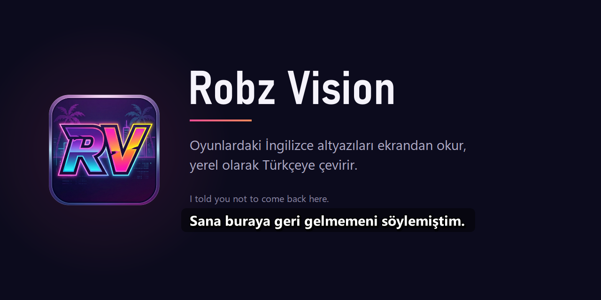
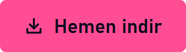
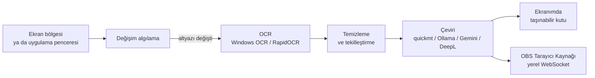
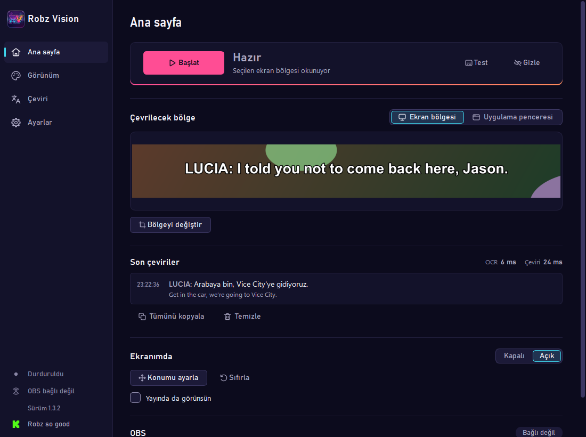

<p align="center">
  
</p>

<p align="center">
  Oyunlardaki İngilizce altyazıları ekrandan okuyup bilgisayarınızda Türkçeye çeviren,<br>
  ücretsiz ve açık kaynak bir Windows uygulaması.
</p>

<p align="center">
  <a href="https://github.com/kutsalkiremitci/robz-vision/releases/latest"></a>
  
  
  
  <a href="LICENSE"></a>
</p>

<p align="center">
  
</p>
<p align="center"><sub>Altta oyunun İngilizce altyazısı, üstünde Robz Vision'ın çevirisi.
Görüntü, depodaki test sahnesinden (<code>tools/test_penceresi.py</code>) alınmıştır.</sub></p>

<p align="center">
  <a href="https://github.com/kutsalkiremitci/robz-vision/releases/latest"></a>
</p>
<p align="center"><sub>Windows 10 / 11, 64 bit (ARM'li Windows 11 dahil). Kurulum dosyası ya da taşınabilir zip/7z; yönetici izni istemez.<br>
Adım adım anlatım için <a href="docs/KULLANIM.md">kullanım kılavuzu</a>.</sub></p>

<p align="center"></p>

## Neden?

Rockstar Games, GTA VI'yı Türkçe altyazı ve Türkçe seslendirme olmadan çıkarıyor: oyunun metin dilleri
arasında Türkçe yok, seslendirmesi yalnızca İngilizce.[^diller] Türkiye'deki oyuncular da hikâyeyi anlayarak
oynayabilsin istedik.

Robz Vision'ı bu yüzden aceleyle, bir iki günde yazdık. Elimizden geleni yaptık; eksikleri olabilir.
Ücretsiz, açık kaynak ve kurcalamadan kullanılabilecek kadar basit olsun istedik.

GTA VI çıkış noktamız ama sınırımız değil: Robz Vision ekranda İngilizce altyazı gösteren her oyunla çalışır.
PC oyunları, PS Remote Play ve Xbox uygulaması gibi uzaktan oynatma pencereleri, emülatörler ve capture kartı
önizlemeleri de buna dahil.

## Özellikler

- **Ücretsiz ve yerel.** OCR (Windows'un kendi OCR'ı) ve çeviri modeli (quickmt) bilgisayarınızda çalışır.
  Hesap, API anahtarı ya da abonelik gerekmez. Varsayılan ayarlarla internet yalnızca ilk açılışta modeli
  indirmek için kullanılır.
- **Hızlı.** OCR yaklaşık 10 ms, çeviri işlemcide 20–60 ms sürer. Altyazı belirdikten kısa süre sonra
  Türkçesi ekranda olur.
- **İki ayrı çıktı.** Kendi ekranınızda taşıyıp boyutlandırabileceğiniz bir altyazı kutusu, izleyicileriniz
  için de bir OBS Tarayıcı Kaynağı. İkisinin konumu birbirinden bağımsızdır.
- **Bölge ya da pencere.** Altyazının çıktığı alanı fareyle seçersiniz. İsterseniz belirli bir uygulama
  penceresinden okursunuz; pencere başka pencerelerin arkasında kalsa da çalışır.
- **Gereksiz iş yapmaz.** Altyazı değişmedikçe OCR çalışmaz. Titreyen okumaları ayıklar, daha temiz bir okuma
  gelirse çeviriyi düzeltir. Konuşmacı adları (`LUCIA: …`) çevrilmez, ayrı renkte gösterilir.
- **Sözlük.** Karakter ve yer adlarını olduğu gibi bırakır ya da sizin verdiğiniz karşılığı kullanır.
- **Görünüm.** Hazır stiller (Klasik, Sinema, Kutulu, Sarı, Minimal), yazı tipi, boyut, renk, kenar, gölge ve
  arka plan. Canlı önizleme vardır; değişiklik ekrana ve OBS'e anında yansır.
- **İsteğe bağlı motorlar.** Ollama ile yerel bir dil modeli, kendi anahtarınızla Google Gemini ya da DeepL.
  Önce yerel çeviri görünür, daha iyi sonuç gelince yerine geçer. Hata olursa yerel çeviriyle devam eder.
- Global kısayollar, sistem tepsisi, çeviri önbelleği ve baştan sona Türkçe arayüz.

<table>
  <tr>
    <td width="50%" valign="top">
      <br>
      <sub>Görünüm sayfası: canlı önizleme, hazır stiller ve yazı ayarları.</sub>
    </td>
    <td width="50%" valign="top">
      <br>
      <sub>Çeviri sayfası: motor seçimi, yerel model durumu ve sözlük.</sub>
    </td>
  </tr>
</table>

## Nasıl çalışır



1. **Yakalama.** Seçtiğiniz bölge saniyede 10 kez yakalanır. Pencere modunda Windows Graphics Capture
   kullanılır.
2. **Değişim algılama.** Görüntü küçültülür ve ince, parlak harf çizgilerinden bir "metin maskesi" çıkarılır.
   Maske belirgin biçimde değişip birkaç kare sabit kalınca OCR tetiklenir. Ekranda aynı altyazı durdukça
   işlemci boşta kalır.
3. **OCR.** Varsayılan motor Windows'un yerleşik OCR'ıdır. Süslü yazı tiplerinde RapidOCR (PP-OCR, ONNX)
   seçilebilir.
4. **Temizleme.** Satırlar birleştirilir, konuşmacı adı ayrılır. Okuma, İngilizce kelime listesine göre
   puanlanır; bozuk okumalar elenir. Aynı cümle ikinci kez çevrilmez, önbellekten gelir.
5. **Çeviri.** Varsayılan model [quickmt-en-tr](https://huggingface.co/quickmt/quickmt-en-tr)'dir ve
   CTranslate2 ile işlemcide çalışır. Yakalama, OCR ve çeviri ayrı iş parçacıklarındadır; her biri yalnızca
   en son veriyi alır. Yavaş bir çeviri sırasında gecikme birikmez, eskiyen altyazılar atlanır.
6. **Gösterim.** Ekrandaki kutu ve OBS sayfası aynı zamanlayıcıya bağlıdır; birlikte belirir, birlikte
   kaybolur. Kısa süren bir altyazının çevirisi okunabilecek kadar ekranda kalır. Ekrandaki kutu varsayılan
   olarak ekran yakalamaya girmez: OCR kendi Türkçe yazısını okumaz, yayında da iki kez görünmez.

## Kimler, nasıl kullanır

| | Nereye bakar | Ne yapar |
|---|---|---|
| **Tek başına oynayan** | Oyun ekranına. Türkçe kutu oyunun üstünde, istediği yerde durur. | Bölgeyi seçer, Başlat'a basar, kutunun konumunu bir kez ayarlar. OBS gerekmez. |
| **Yayıncı** (Kick, Twitch, YouTube) | Kendi ekranındaki kutuya; izleyiciler OBS'teki altyazıyı görür. | Ana sayfadaki adresi OBS'e Tarayıcı Kaynağı olarak ekler. İsterse OBS'te İngilizce altyazının üstünü kapatır. |
| **İzleyici** | Yayına. | Hiçbir şey kurmaz. Altyazının görünümünü yayıncı Görünüm sayfasından ayarlar. |

**Konsolda oynuyorsanız:** Robz Vision Windows'ta çalışır, bu yüzden oyun görüntüsünün bilgisayar ekranında
olması gerekir. PS Remote Play ya da Xbox uygulamasıyla uzaktan oynatabilir veya capture kartının görüntüsünü
bir pencerede açabilirsiniz. Ayrıntılar ve OBS kurulumu için [kullanım kılavuzu](docs/KULLANIM.md).

<p align="center"></p>

## Kurulum

**Kurulum dosyası (önerilen).** [Releases](https://github.com/kutsalkiremitci/robz-vision/releases/latest)
sayfasından `RobzVision-Kurulum-<sürüm>-x64.exe` dosyasını indirip çalıştırın ve sihirbazda **İleri**'ye
basarak kurun. Yönetici izni istemez; program kendi kullanıcı klasörünüze kurulur, Başlat menüsüne eklenir ve
*Ayarlar → Uygulamalar*'dan kaldırılabilir. İlk açılışta ücretsiz çeviri modeli (yaklaşık 400 MB) bir kez
indirilir; indirme bitince program açılır.

**Taşınabilir sürüm.** `RobzVision-Tasinabilir-<sürüm>-x64.zip` (ya da daha küçük `.7z`) dosyasını kısa bir
klasöre (ör. `C:\RobzVision`) çıkarıp `RobzVision.exe`'yi çalıştırın. İndirilen dosyayı doğrulamak için
sürüm sayfasında `SHA256SUMS.txt` vardır.

**ARM işlemcili bilgisayarlar.** Ayrı bir ARM64 sürümü yok; çeviri motorunun (CTranslate2) ve birkaç
kütüphanenin ARM64 Windows paketi bulunmuyor. Windows 11 x64 programları öykünmeyle çalıştırabildiği için
kurulum dosyası ARM'li Windows 11'e de kurulur (henüz ARM cihazda denenmedi).

**Kaynak koddan.** [Python 3.12](https://www.python.org/downloads/) kurun ("Add python.exe to PATH"
işaretli). Depoyu indirip `kurulum.bat`'ı, ardından `baslat.bat`'ı çalıştırın.

**Gereksinimler.** Windows 10 (2004 ve sonrası) ya da Windows 11, 64 bit. Windows'un **İngilizce OCR dil
paketi** de gerekir. Yoksa *Ayarlar → Saat ve dil → Dil ve bölge → English (United States)* ekleyin ya da
yönetici PowerShell'de şunu çalıştırın:

```powershell
Add-WindowsCapability -Online -Name "Language.OCR~~~en-US~0.0.1.0"
```

## İlk kullanım

<p align="center">
  
</p>

1. **Tanıtım turu.** İlk açılışta kısa bir tur arayüzün bölümlerini gösterir. Atlarsanız
   *Ayarlar → Tanıtım turunu başlat* ile yeniden açabilirsiniz.
2. **Bölge seç.** Ana sayfada **Bölge seç**'e basın. Ekran kararır, oyun arkada akmaya devam eder.
   Altyazının çıktığı alanı fareyle çizip **Onayla**'ya basın.
3. **Başlat.** Altyazı ekrana geldiğinde Türkçesi de gelir.
4. **Ekranımda → Konumu ayarla.** Türkçe kutuyu istediğiniz yere sürükleyin, kenarlarından boyutlandırın,
   bitirmek için çift tıklayın.
5. **OBS (isteğe bağlı).** Ana sayfadaki adresi kopyalayın, OBS'te **Tarayıcı** kaynağı olarak ekleyin:
   *Yerel dosya* işaretsiz, genişlik ve yükseklik tuvalle aynı (ör. 1920 × 1080), kaynak oyun görüntüsünün
   üstünde.

Kısayollar: `Ctrl+Alt+T` başlat/durdur, `Ctrl+Alt+H` gizle/göster, `Ctrl+Alt+C` temizle.
Ayarlar sayfasından değiştirilebilir.

Adım adım anlatım, ekran görüntüleri ve senaryolara göre ipuçları: **[docs/KULLANIM.md](docs/KULLANIM.md)**

## Çeviri motorları

| Motor | Maliyet | Yaklaşık süre | Gereken |
|---|---|---|---|
| **Yerel, quickmt** (varsayılan) | Ücretsiz | 20–60 ms | Hiçbir şey |
| **Ollama:** TranslateGemma 4B / 12B | Ücretsiz, yerel | 0,2–1,3 sn | [Ollama](https://ollama.com/download), 3–8 GB model |
| **Ollama:** Gemma 4, Qwen 3.5, Hy-MT2 | Ücretsiz, yerel | 0,3–1 sn | Ollama |
| **Google Gemini** | Ücretsiz katman | 0,3–0,8 sn | Kendi API anahtarınız |
| **DeepL API Free** | Ayda 500 bin karaktere kadar ücretsiz | ~0,3 sn | Kendi API anahtarınız |

Süreler donanıma ve bağlantıya göre değişir. Dil modeli ve çevrimiçi motorlarda önce yerel çeviri görünür,
sonuç gelince yerine geçer. Ticari olmayan lisanslı modeller (ör. NLLB) para kazanılan yayınlarla çeliştiği
için kullanılmadı.

## Gizlilik

- Varsayılan ayarlarla ekran görüntüsü, OCR ve çeviri bilgisayarınızda kalır. Görüntüler diske kaydedilmez,
  uygulama kullanım verisi toplamaz.
- İnternet bağlantısı yalnızca ilk açılışta çeviri modelini Hugging Face'ten indirmek için kullanılır.
  RapidOCR'ı seçerseniz o da kendi modellerini ilk kullanımda indirir.
- OBS sunucusu yalnızca `127.0.0.1` adresini dinler; ağdaki başka cihazlar erişemez.
- Çeviri önbelleği (İngilizce–Türkçe metin çiftleri) ve günlük dosyaları `%LOCALAPPDATA%\RobzVision`
  altında, ayarlar ve API anahtarları `%APPDATA%\RobzVision\ayarlar.json` dosyasında tutulur.
- Gemini ya da DeepL'i seçerseniz altyazı metni ve bağlam için önceki birkaç satır o hizmete gönderilir;
  görüntü gönderilmez. **Gemini'nin ücretsiz katmanında Google, gönderilen metinleri ürünlerini geliştirmek
  için kullanabilir.**

## SSS ve sorun giderme

<details>
<summary><b>Altyazı algılanmıyor</b></summary>

Bölgenin altyazıyı tam kapsadığını kontrol edin. *Ayarlar → Metin okuma → Gelişmiş*'te *Parlaklık eşiği*ni
düşürün ya da *Algılama*'yı *Sabit aralık* yapın. Harf harf beliren altyazılarda *Kararlılık*'ı artırın.
</details>

<details>
<summary><b>Yanlış ya da yarım okumalar</b></summary>

Bölgeyi yalnızca altyazı satırlarını kapsayacak kadar daraltın. Süslü yazı tiplerinde *Ayarlar → Metin okuma*'da
motor olarak RapidOCR'ı deneyin.
</details>

<details>
<summary><b>Türkçe kutu oyunun üstünde görünmüyor</b></summary>

Oyunu *Pencereli tam ekran* (kenarlıksız) modunda çalıştırın. Bazı oyunlar özel tam ekran modunda başka
pencereleri üstte göstermez. *Ekranımda*'nın *Açık* olduğunu da kontrol edin.
</details>

<details>
<summary><b>OBS'te altyazı yok</b></summary>

Ana sayfada OBS durumu *Bağlı* olmalı. Tarayıcı kaynağında *Yerel dosya* işaretsiz olmalı ve kaynak, oyun
görüntüsünün üstünde durmalı. Görünüm sayfasındaki **Test et** düğmesi örnek bir altyazı gönderir.
</details>

<details>
<summary><b>"Windows'ta İngilizce OCR dil paketi yüklü değil" hatası</b></summary>

[Kurulum](#kurulum) bölümündeki komutla paketi kurun ya da *Ayarlar → Metin okuma*'da RapidOCR'a geçin.
</details>

<details>
<summary><b>Pencere modunda görüntü gelmiyor</b></summary>

Pencere simge durumuna küçültülmüş olmamalı. Başka pencerelerin arkasında kalması sorun değildir.
</details>

<details>
<summary><b>Windows "bilinmeyen yayımcı" uyarısı veriyor</b></summary>

Kurulum dosyası dijital olarak imzalı değil. SmartScreen uyarısında *Ek bilgi → Yine de çalıştır*'ı
seçebilirsiniz. Dosyayı yalnızca bu deponun Releases sayfasından indirin.
</details>

<details>
<summary><b>Oyunun dosyalarına dokunuyor mu?</b></summary>

Hayır. Robz Vision oyuna kod eklemez, belleğini ya da dosyalarını okumaz; yalnızca ekranda görüneni okur.
Çevrim içi oyunlarda yine de oyunun kullanım koşullarını kendiniz kontrol edin.
</details>

<details>
<summary><b>Kısayollar çalışmıyor</b></summary>

Başka bir program aynı tuşları kullanıyor olabilir. Ayarlar sayfasından değiştirin.
</details>

<details>
<summary><b>Kaldırınca her şey silinir mi?</b></summary>

Program dosyaları silinir. Ayarlar (`%APPDATA%\RobzVision`) ve indirilen model (`%LOCALAPPDATA%\RobzVision`)
yeniden kurulumda tekrar indirme gerekmesin diye kalır; isterseniz bu klasörleri elle silebilirsiniz.
</details>

Hata bildirirken günlük dosyasını ekleyin: *Ayarlar → Uygulama → Günlükler* ya da
`%LOCALAPPDATA%\RobzVision\Logs`.

<p align="center"></p>

## Geliştirme

```powershell
python -m venv .venv
.venv\Scripts\python -m pip install -r requirements-dev.txt
.venv\Scripts\python -m pytest -q tests
.venv\Scripts\python -m altyazitr --debug
```

| Araç | Ne işe yarar |
|---|---|
| `tools/test_penceresi.py` | Oyun olmadan denemek için İngilizce altyazılı sahte bir oyun penceresi |
| `tools/arayuz_goruntusu.py` | Arayüzün tüm ekranlarını pencere açmadan PNG olarak kaydeder |
| `tools/readme_gorselleri.py` | Bu sayfadaki görselleri (banner dahil) `docs/gorseller/` altında yeniden üretir |
| `tools/kurulum_gorselleri.py`, `tools/logo_hazirla.py` | Kurulum sihirbazı görselleri, logo ve simge |
| `tools/kelime_listesi_olustur.py` | OCR kalite puanındaki İngilizce kelime listesini (`altyazitr/data/en_words.txt`) üretir |
| `tools/surum_notlari.py` | GitHub sürüm sayfasının metnini (indirme rehberi + CHANGELOG) üretir |
| `derle.bat`, `kurulum_paketi.bat` | Taşınabilir sürüm (PyInstaller) ve kurulum dosyası (Inno Setup 6) |

`v*` biçiminde bir etiket gönderildiğinde GitHub Actions testleri çalıştırır; kurulum dosyasını, taşınabilir
zip ve 7z arşivlerini, `SHA256SUMS.txt`'yi derleyip sürüm notlarıyla (`tools/surum_notlari.py`) Releases'e
ekler (`.github/workflows/release.yml`). Etiket, `altyazitr/__init__.py`'deki sürümle aynı olmalıdır.

| Dosya | Görev |
|---|---|
| `altyazitr/capture.py` | Ekran bölgesi (mss) ve pencere (Windows Graphics Capture) yakalama |
| `altyazitr/detect.py` | Değişim algılama (metin maskesi) |
| `altyazitr/ocr.py`, `textproc.py`, `english.py` | OCR motorları, metin temizleme, okuma kalite puanı |
| `altyazitr/translate.py` | quickmt, Ollama, Gemini, DeepL; sözlük ve önbellek |
| `altyazitr/pipeline.py` | Yakalama → OCR → çeviri iş parçacıkları |
| `altyazitr/display.py`, `server.py`, `web/overlay.html` | Zamanlama ve OBS Tarayıcı Kaynağı |
| `altyazitr/overlay.py`, `render.py` | Ekrandaki altyazı kutusu ve ortak çizim kodu |
| `altyazitr/gui/` | PySide6 arayüzü; tasarım kuralları [DESIGN.md](DESIGN.md)'de |

Python paket adı tarihsel nedenlerle `altyazitr` olarak kaldı.

## Katkı

Hata bildirimi, oyuna özel ayar önerisi ve kod katkısı için [CONTRIBUTING.md](CONTRIBUTING.md)'ye bakın.
Değişiklik geçmişi [CHANGELOG.md](CHANGELOG.md)'de.

## Lisans

Kaynak kod [MIT](LICENSE) lisanslıdır. Kullanılan bileşenlerin ve çeviri modelinin lisansları
[THIRD_PARTY_NOTICES.md](THIRD_PARTY_NOTICES.md)'de. Varsayılan çeviri modeli quickmt-en-tr,
CC BY 4.0 lisanslıdır ve programla birlikte dağıtılmaz, ilk açılışta indirilir.

Robz Vision bağımsız, gönüllü bir açık kaynak projedir. Rockstar Games, Take-Two Interactive, Sony
Interactive Entertainment, Microsoft, OBS Project, Kick, Twitch, YouTube, Google veya DeepL ile bağlantılı
değildir ve bu şirketlerce desteklenmez. Grand Theft Auto, GTA ve Rockstar Games, Take-Two Interactive
Software, Inc.'in ticari markalarıdır; adı geçen diğer markalar da sahiplerine aittir. Bu depoda hiçbir oyuna
ait logo veya görsel yoktur; demo görüntüleri depodaki sahte test sahnesinden üretilmiştir, tanıtım görseli
(gün batımı, deniz ve palmiyeler) `tools/readme_gorselleri.py` içinde kodla çizilir.

[^diller]: PlayStation'ın resmî GTA VI destek sayfasındaki dil tablosu 13 metin dili listeler (İngilizce,
Fransızca, Almanca, İtalyanca, Japonca, Korece, Lehçe, Brezilya Portekizcesi, Rusça, Basitleştirilmiş ve
Geleneksel Çince, Meksika ve İspanya İspanyolcası); seslendirme yalnızca İngilizcedir. Türkçe yoktur.
Xbox mağaza sayfası da 13 desteklenen dil gösterir. Kaynaklar, 16 Kasım 2026'da kontrol edildi:
[PlayStation destek sayfası](https://www.playstation.com/en-us/support/games/gta-vi-support/),
[Xbox mağaza sayfası](https://www.xbox.com/en-IN/games/store/grand-theft-auto-vi/9p3h4968grsm).
