# Robz Vision kullanım kılavuzu

Bu kılavuz, Robz Vision'ı ilk kez kuran birinin oyunda Türkçe altyazı görene kadar yapacağı her adımı
anlatır. [Senaryolar](#8-senaryolar) bölümünde oyunu nerede oynadığınıza göre dört yol (bilgisayar, PS5 ve
bilgisayar, televizyon, capture kartı) çizimleriyle ve yayıncılar için ipuçları var.

Kurulum için [README'deki Kurulum bölümüne](../README.md#kurulum), kısa ve çizimli bir başlangıç için
[Adım adım kurulum rehberi](../README.md#adım-adım-kurulum-rehberi)'ne bakın.

| Oyunun kendi altyazısı | Robz Vision açıkken |
|---|---|
| 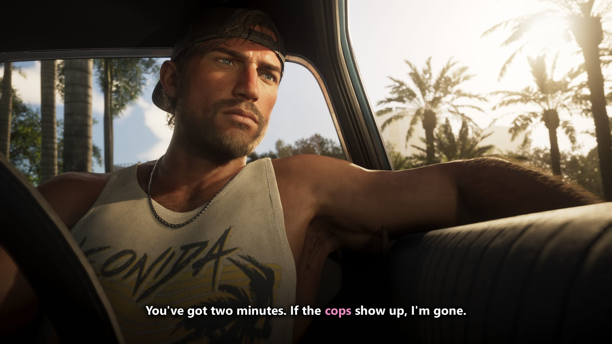 | 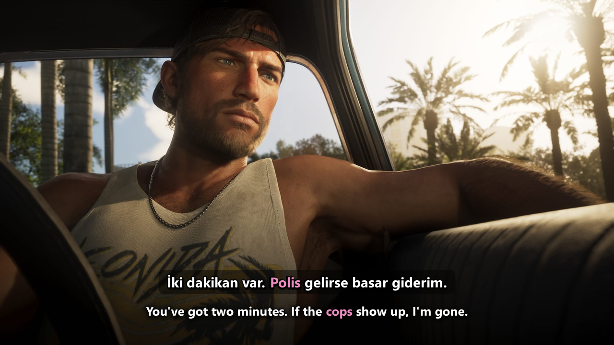 |

Oyun görseli © Rockstar Games / Take-Two Interactive (GTA VI resmî tanıtım görseli); Robz Vision bağımsız bir
hayran projesidir, Rockstar Games ile bir bağlantısı yoktur. Altyazı cümleleri örnektir, oyundan alıntı değildir;
Türkçe kutu uygulamanın kendi çizim koduyla çizilmiştir (`tools/readme_gorselleri.py`).

## İçindekiler

1. [Başlamadan önce](#1-başlamadan-önce)
2. [Bölgeyi seçin](#2-bölgeyi-seçin)
3. [Başlatın](#3-başlatın)
4. [Türkçe kutuyu ekranınıza yerleştirin](#4-türkçe-kutuyu-ekranınıza-yerleştirin)
5. [OBS'e ekleyin](#5-obse-ekleyin)
6. [Görünümü ayarlayın](#6-görünümü-ayarlayın)
7. [Çeviriyi iyileştirin](#7-çeviriyi-iyileştirin)
8. [Senaryolar](#8-senaryolar)
   - [Yol 1: Bilgisayarda oynuyorum](#yol-1-bilgisayarda-oynuyorum)
   - [Yol 2: PS5'i bilgisayar ekranında oynuyorum](#yol-2-ps5i-bilgisayar-ekranında-oynuyorum)
   - [Yol 3: PS5'i televizyonda oynuyorum](#yol-3-ps5i-televizyonda-oynuyorum)
   - [Yol 4: Capture kartıyla oynuyorum](#yol-4-capture-kartıyla-oynuyorum)
   - [Yayın yapıyorum](#yayın-yapıyorum)
9. [Kısayollar](#9-kısayollar)
10. [Sorun giderme](#10-sorun-giderme)

## 1. Başlamadan önce

**Oyun görüntüsü bilgisayar ekranında olmalı.** Robz Vision Windows'ta çalışır ve ekranda gördüğünü okur;
televizyonda ya da konsolda çalışmaz. PC'de oynuyorsanız ek bir şey gerekmez. Konsolda oynuyorsanız görüntüyü
bilgisayara şu yollardan biriyle getirin:

- **chiaki-ng**, **PS Remote Play** ya da **Xbox uygulaması** ile konsolu bilgisayardan oynatın
  ([Yol 2](#yol-2-ps5i-bilgisayar-ekranında-oynuyorum)). Bilgisayarı TV'ye bağlarsanız çeviri TV'de görünür
  ([Yol 3](#yol-3-ps5i-televizyonda-oynuyorum)).
- **Capture kartının** görüntüsünü bir pencerede açın: kartın kendi uygulaması ya da OBS'in
  *Pencereli Projektör (Kaynak)* penceresi ([Yol 4](#yol-4-capture-kartıyla-oynuyorum)).

**Oyunda İngilizce altyazıyı açın.** Robz Vision ses dinlemez, yalnızca ekrandaki yazıyı okur.
Altyazı ne kadar okunaklıysa (büyük, kenarlı ya da arka planlı) sonuç o kadar iyi olur.

### Neler lazım

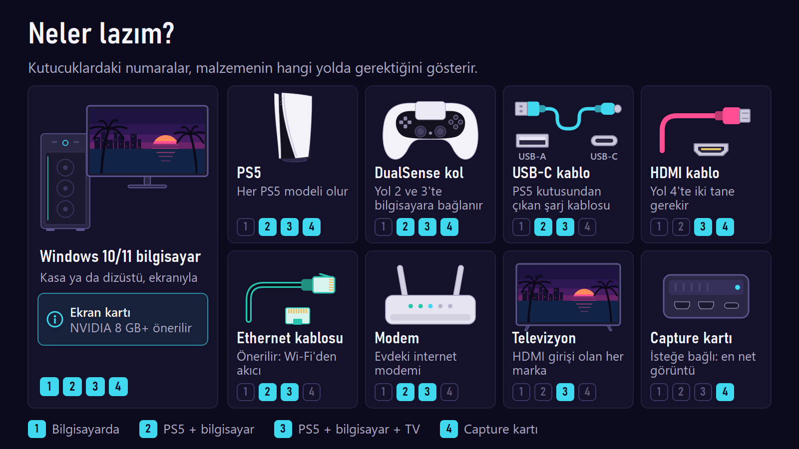

- **Her yolda:** Windows 10 (2004 ve sonrası) ya da Windows 11, 64 bit bir bilgisayar ve monitör. Ekran kartı
  gerekmez; yerel yapay zekâ çevirisi için en az 8 GB bellekli NVIDIA ya da AMD kart gerekir
  ([Sistem gereksinimleri](../README.md#sistem-gereksinimleri)).
- **PS5'i bilgisayardan oynamak için (Yol 2):** PS5 ve DualSense; kolu bilgisayara bağlayan USB-C kablo (PS5'in
  kutusundan çıkan şarj kablosu; Bluetooth da olur); PS5'in ve bilgisayarın bağlı olduğu modem; ücretsiz
  chiaki-ng. PS5'i modeme bağlayan bir Ethernet kablosu önerilir: görüntü netleşir, okuma iyileşir.
- **Televizyonda oynamak için (Yol 3):** ayrıca bir HDMI kablo ve HDMI girişli bir TV. Marka fark etmez.
- **Capture kartıyla (Yol 4):** PS5, capture kartı, HDMI kablolar ve OBS.

### İlk açılış

Program ilk açıldığında çevirinin nasıl yapılacağını sorar. Ana pencere açılınca kısa bir tanıtım turu
arayüzün bölümlerini gösterir. Turu atlarsanız *Ayarlar → Tanıtım turunu başlat* ile istediğiniz zaman
yeniden açabilirsiniz.

**1. Seçim: Çeviri nasıl yapılsın?** İki seçenek var:

- **Yapay zekâ ile:** konuşmayı takip eder, argoyu anlar. Robz Vision, Ollama'yı (yapay zekâyı çalıştıran
  ücretsiz program) ve Gemma 4 modelini kurar; yaklaşık 10 GB iner. İnternetsiz çalışır. Hızlı çeviri yedekte
  kalır: yapay zekâ gecikirse o görünür.
- **Yalnız hızlı çeviri:** her bilgisayarda çalışır, anında çevirir; bazen düz ya da yanlış çevirir. 404 MB.

Robz Vision ekran kartınızı okur ve adını seçeneğin altında gösterir. Yapay zekâ için en az 8 GB belleği olan
bir NVIDIA ya da AMD ekran kartı gerekir; kartınız uygunsa *Yapay zekâ ile* önceden seçili gelir. 6 GB'lık
kartta da seçebilirsiniz ama yayın açıkken çeviri gecikebilir. Uygun kart yoksa bu seçenek soluk görünür ve
seçilemez. Seçiminizi sonra *Çeviri* sayfasından değiştirebilirsiniz.

Hızlı çeviri modeli iki seçenekte de gerekir: pencere açılır açılmaz inmeye başlar, ilerlemesi pencerenin
altında görünür. **Çıkış**'a basarsanız program açılmaz; indirme sonraki açılışta tamamlanır.

**2. Onay.** *Yapay zekâ ile*'yi seçip **Devam**'a basınca indirilecekler ve boyutları listelenir: Ollama
(1,9 GB), model (Gemma 4 12B 8,0 GB ya da daha hafif Gemma 4 E4B 6,6 GB; ekran kartınıza göre seçili gelir),
toplam indirme ve boş disk alanı. Oyun da bu bilgisayarda çalışıyorsa E4B'yi seçebilirsiniz; daha hızlı ve
hafiftir. **Kur**'a basmadan yapay zekâ için hiçbir şey inmez. Diskte yer yetmiyorsa **Kur** kapalı kalır.
Ollama ya da model zaten kuruluysa satırında *Kurulu* yazar; ikisi de kuruluysa bu ekran atlanır, yalnız ayar
yapılır.

**3. İlerleme.** Her adım kendi satırında görünür: Ollama'nın indirilmesi, imza ve bütünlük denetimi,
kurulumu (1–2 dk), başlatılması, ekran kartının denetimi ve modelin indirilmesi. Altta toplam ilerleme,
indirme hızı ve kalan süre yazar. Yapay zekâ indirmesi hızlı çeviri modeli inince başlar.

- **Şimdi başla** hızlı çeviri modeli inince açılır. Basınca ana pencere açılır ve hızlı çeviriyle
  başlarsınız; yapay zekâ arka planda iner, hazır olunca devreye girer.
- **Yapay zekâyı iptal et** kurulumu durdurur, hızlı çeviri kalır. *Ollama kuruluyor* adımında iptal
  edilemez; kurulum bitince durur.
- Ekran kartı denetiminde Ollama kartınızı kullanamıyorsa model indirilmez. Kartın belleği Gemma 4 12B'ye
  yetmiyorsa yerine daha hafif E4B iner.
- Bir adım başarısız olursa satırı kırmızı olur ve altında nedeni yazar. **Tekrar dene** kaldığı yerden
  sürer, **Hızlı çeviride kal** yapay zekâdan vazgeçer. Çözümler: [Yapay zekâ kurulumu](#yapay-zekâ-kurulumu).

**4. Sonuç.** Her şey bitince *Yapay zekâ hazır* yazar; **Başla** ile programı açın. Çeviri motoru
kendiliğinden yapay zekâya geçer.

**Şimdi başla**'ya bastıktan sonra kurulum arka planda sürer:

- Kenar çubuğundaki yapay zekâ satırı ilerlemeyi gösterir; tıklayınca *Çeviri* sayfası açılır. İlerleme ve
  **İptal** orada da vardır.
- **Çeviri çalışırken indirme durur:** büyük indirme yayın bağlantınızı ve Wi-Fi'deki Remote Play görüntüsünü
  bozabilir. Çeviriyi durdurunca indirme kaldığı yerden sürer. Beklemek istemiyorsanız *Çeviri* sayfasında
  **Yine de sürdür**'e basın.
- Kurulum bitince bildirim çıkar. Çeviri o sırada çalışıyorsa yapay zekâ bir sonraki **Başlat**'ta devreye
  girer.
- Programı kurulum bitmeden kapatırsanız iş sonraki açılışta kaldığı yerden sürer. Hatayla biten kurulum
  kendiliğinden sürmez; *Çeviri* sayfasında **Tekrar dene**'ye basın.

## 2. Bölgeyi seçin

Ana sayfadaki **Çevrilecek bölge** bölümü (geniş pencerede sağda, büyük) OBS'in önizlemesi gibi kaynağın canlı
görüntüsünü gösterir: ekranınızın ya da seçtiğiniz pencerenin tamamı. Okunan bölge bu görüntünün üstünde
camgöbeği çerçeveyle işaretlidir; çerçevenin dışı karartılır, çerçevenin üstünde bölgenin boyutu (piksel)
yazar. Bölümün başlığındaki seçimle iki yoldan birini seçersiniz:

- **Ekran** (önerilen): ekranın herhangi bir yerinden okunur; önizlemede ekranın tamamı görünür. Birden çok
  ekranınız varsa (ör. monitör ve TV) önizlemenin üstündeki listeden hangi ekranı göreceğinizi seçin.
- **Uygulama penceresi:** listeden okunacak pencereyi seçersiniz; önizlemede o pencerenin görüntüsü belirir ve
  bölgeyi pencerenin üstünde çizersiniz. Liste kendiliğinden güncellenir (yeni açılan pencereler eklenir);
  yenile düğmesiyle de tazelenir. Pencere başka pencerelerin arkasında kalsa da okunur, ama simge durumuna
  küçültülmemeli; küçültülürse önizlemenin köşesinde uyarı çıkar. Oyunu ikinci ekranda ya da başka pencerelerin
  arkasında tutuyorsanız bu yolu seçin.

**Bölgeyi önizlemede çizin.** Oyunun görüntüsü ekrandayken:

- Altyazının çıktığı alanı önizlemede fareyle çizin: çerçevenin dışında bir yere basıp sürükleyin.
- Çerçeveyi ortasından tutup taşıyın, kenarlarından ya da köşelerinden boyutlandırın.
- Önizlemeye tıkladıktan sonra ok tuşları çerçeveyi taşır, Shift ile ok tuşları boyutlandırır.
- Değişiklik hemen kaydedilir ve geçerli olur, çeviri sürerken de.

**İlk açılışta bölge hazır gelir.** Bölge hiç seçilmemişse birincil ekranın alt-orta altyazı şeridi (GTA VI'nın
altyazısının yeri) seçili gelir; altyazı oradaysa doğrudan **Başlat**'a basabilirsiniz, değilse çerçeveyi
kaydırın. Pencere modunda da ilk bölge aynı şerittir. Daha önce seçtiğiniz bölge korunur.

**Tam ekranda seç** (bölümün başlığında) ince ayar içindir: bölgeyi gerçek boyutunda çizersiniz. Ekran
modunda ekran kararır, oyun arkada akmaya devam eder; alanı fareyle çizip **Onayla**'ya basın. Pencere
modunda pencerenin o anki görüntüsü ayrı bir pencerede açılır; alanı çizip **Kaydet**'e basın.

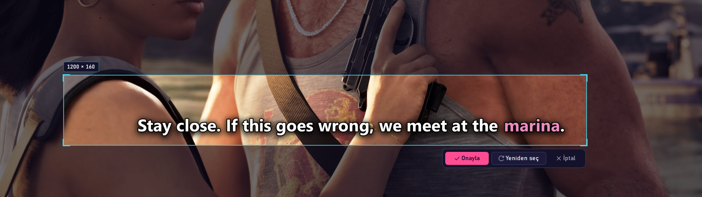

İyi bir bölge için:

- Altyazının en uzun ve en çok satırlı hâlini kapsayın; iki satırlık altyazılara yer bırakın.
- Mini harita, görev yazısı, para göstergesi gibi arayüz öğelerini dışarıda bırakın. Bırakamıyorsanız
  *Ayarlar → Metin okuma → Gelişmiş → Yalnızca en alttaki satırları oku* açık kalsın.
- Bölgeye giren araç plakası, tabela ya da duvar yazısı çevrilmez: *Ayarlar → Metin okuma → Yalnız altyazıları
  oku* yalnız altyazı biçimindeki (beyaz, koyu kenarlı ya da gölgeli, ortalı) yazıyı okur. Altyazısı renkli,
  kenarsız ya da sola dayalı bir oyunda bu ayarı kapatın.
- Bölgeyi gereğinden büyük tutmayın. Küçük bölge hem daha hızlı hem daha doğru okunur.

Çeviri sürerken önizlemenin altında *Okunan bölge* görünür: programın okuduğu kare. Metin olarak algılanan
yerler yeşile boyanır, yanında *Metin var* ya da *Metin yok* yazar; altyazı geldiğinde yeşil alan görünmüyorsa
bölge ya da eşik ayarı yanlıştır.

Canlı önizleme yalnız ekranda gösterilir; kaydedilmez, hiçbir yere gönderilmez. Az yük bindirir (saniyede
birkaç kare, küçültülmüş) ve Ana sayfa görünmüyorken ya da Robz Vision simge durumundayken durur.

## 3. Başlatın

**Başlat**'a basın. Üstteki çubukta *Çalışıyor* yazar. Oyunda altyazı belirince Türkçesi ekrandaki kutuda ve
OBS'te görünür.

- **Test** düğmesi ekranınızda ve OBS'te 5 saniyelik örnek bir altyazı gösterir. Oyun açmadan görünümü
  denemek için kullanın.
- **Gizle** çeviriyi geçici olarak gizler; program okumaya devam eder.
- **Altyazı akışı** (*Ayarlar → Altyazı akışı*): *Akış*'ta son çeviriler ekranda ve OBS'te alt alta kalır,
  hızlı konuşmada satır kaybolmaz. Ekranda en fazla kaç satır duracağını (2–4) ve her satırın en az kaç saniye
  kalacağını buradan seçersiniz. Yalnız son çeviriyi görmek isterseniz *Tek satır*'ı seçin.
- **En uzun kalma** (*Ayarlar → Altyazı akışı*): her satır en fazla bu kadar ekranda kalır (varsayılan 7 sn,
  3–20 sn arası; uzun satırlara okuma süresi kadar pay eklenir). Böylece oyunda sabit duran bir yazı (tuş
  ipucu, menü) çeviriyi ekranda tutmaz: süresi dolup kalkan satır, yazı oyunda dursa da geri gelmez.

En son satırın OCR ve çeviri süreleri üstteki çubukta, **Test** düğmesinin solunda durur.

Ana sayfadaki **Son çeviriler** listesi (geniş pencerede solda, boydan boya) bu oturumda okunan satırları
Türkçesi ve İngilizcesiyle gösterir, en yenisi üstte. Kaçırdığınız bir satırı buradan okuyabilirsiniz:

- Satırın üzerine gelip sağdaki kopyala simgesine basın, Türkçesi kopyalanır. Sağ tıklayıp
  *İngilizce + Türkçe kopyala*'yı da seçebilirsiniz.
- **Tümünü kopyala** listedeki satırları eskiden yeniye, saatiyle kopyalar. **Temizle** listeyi boşaltır.
- Liste yalnız bellekte tutulur (son 200 satır), diske yazılmaz. Uygulamayı kapatınca silinir.

## 4. Türkçe kutuyu ekranınıza yerleştirin

Ana sayfadaki **Ekranımda** bölümü kendi ekranınızdaki altyazı kutusunu yönetir.

1. **Ekranımda**'yı **Açık** yapın.
2. **Konumu ayarla**'ya basın. Kutu, gerçek görünümüyle ve bir örnek cümleyle belirir.
3. Kutuyu sürükleyerek taşıyın, kenarlarından boyutlandırın.
4. Bitirmek için kutuya çift tıklayın ya da **Konumu kaydet**'e basın.

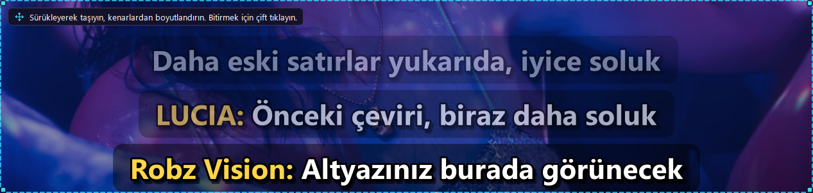

Konum ipuçları:

- En rahat yer, oyunun İngilizce altyazısının hemen üstüdür; gözünüz iki satır arasında gidip gelmez.
- Kutu, okunan bölgenin üstüne gelse bile sorun olmaz. Kutu ekran yakalamaya girmez, bu yüzden Robz Vision
  kendi Türkçe yazısını okumaz.
- **Sıfırla** kutuyu varsayılan konumuna döndürür. Kutudaki yazının görünümünü (boyut, renk, arka plan)
  *Görünüm* sayfasında **Ekranımda** seçiliyken ayarlarsınız; yayındaki altyazı bundan etkilenmez.
- Kutu oyunun üstünde görünmüyorsa oyunu *Pencereli tam ekran* (kenarlıksız) modunda çalıştırın.
- Birden çok ekranınız varsa (ör. monitör ve TV) kutuyu oyunun açık olduğu ekrana sürükleyin. Bölgeyi de o
  ekranda seçin: önizlemenin üstündeki listeden ekranı seçip çizin ya da **Tam ekranda seç**'i kullanın (bütün
  ekranlarda açılır).

**Yayında da görünsün** seçeneği kutuyu ekran yakalamaya açar. Yalnızca OBS'te *Ekran Yakalama* ile yayın
yapıyor ve tarayıcı kaynağı kullanmak istemiyorsanız açın. Bu seçenek açıkken kutu okunan bölgenin üstüne
gelirse Robz Vision *Kutu okunan bölgenin üstünde* uyarısı verir; kutuyu bölgenin dışına taşıyın.

## 5. OBS'e ekleyin

İzleyicilerinizin de Türkçe altyazı görmesi için Ana sayfanın **OBS** bölümündeki adresi OBS'e ekleyin.
Adresin yanındaki soru işareti düğmesi aynı adımları uygulama içinde gösterir.

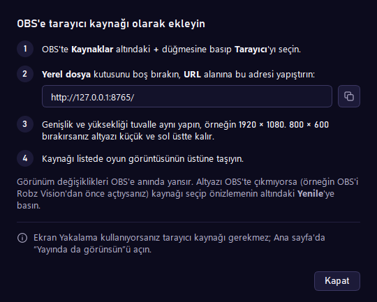

1. OBS'te **Kaynaklar** altındaki **+** düğmesine basıp **Tarayıcı**'yı seçin.
2. **Yerel dosya** kutusunu boş bırakın, **URL** alanına Ana sayfadaki adresi yapıştırın
   (varsayılan: `http://127.0.0.1:8765/`).
3. Genişlik ve yüksekliği tuvalle aynı yapın, örneğin 1920 × 1080. Varsayılan 800 × 600'de bırakırsanız
   altyazı küçük ve tuvalin sol üstünde kalır.
4. Kaynağı listede oyun görüntüsünün üstüne taşıyın.

Bağlantı kurulunca Ana sayfada ve kenar çubuğunda *OBS bağlı* yazar. Yalnızca OBS'teki kaynak sayılır; adresi
bir web tarayıcısında açmak bu yazıyı değiştirmez. Görünüm değişiklikleri OBS'e anında yansır; kaynağı
yeniden yüklemeniz gerekmez.

**OBS'te altyazı çıkmıyor, tarayıcıda çıkıyorsa:** OBS'i Robz Vision'dan önce açtıysanız tarayıcı kaynağı
sayfayı yükleyemez ve OBS bunu kendiliğinden yeniden denemez; kaynak boş kalır. OBS'te kaynağı seçip
önizlemenin altındaki **Yenile**'ye basın (ya da kaynağa çift tıklayıp *Geçerli sayfanın önbelleğini
yenile*'ye basın). Kaynak bir kez yüklendikten sonra OBS sayfanın kopyasını saklar; sonraki açılışlarda
hangisini önce açtığınız fark etmez, Robz Vision açılınca altyazı kendiliğinden gelir.

Bilmeniz gerekenler:

- Adres yalnızca aynı bilgisayarda çalışır. İki bilgisayarlı yayın düzeninde Robz Vision'ı OBS'in çalıştığı
  bilgisayara kurun.
- OBS'teki altyazının görünümü, yeri ve genişliği ekrandaki kutudan bağımsızdır: *Görünüm → Yayınımda →
  Konum ve genişlik → OBS'te alttan* ve *OBS'te genişlik*.
- İzleyiciler İngilizce ve Türkçe altyazıyı üst üste görmesin istiyorsanız *Görünüm → Yayınımda → Gelişmiş
  ayarlar → OBS'te orijinali kapat*'ı açın. Robz Vision, seçtiğiniz bölgenin üstüne yalnızca OBS'te bir kutu
  koyar. Oyun görüntüsü OBS tuvalini tam kaplıyorsa kutu birebir oturur.
- Port başka bir programla çakışırsa *Ayarlar → OBS → Port*'tan değiştirip uygulamayı yeniden başlatın,
  OBS'teki adresi de güncelleyin.

## 6. Görünümü ayarlayın

Ekranınızdaki kutu ile yayındaki altyazı ayrı ayarlanır. Örneğin kendi ekranınızda küçük yazı, yayında
arka planlı büyük yazı kullanabilirsiniz. **Görünüm** sayfasının en üstünde hangisini düzenlediğinizi seçin:

- **Ekranımda:** oyunun üstünde sizin gördüğünüz kutu.
- **Yayınımda:** izleyicilerin OBS'te gördüğü altyazı.

Değişiklik seçili tarafa anında yansır. Önizleme seçili tarafı gösterir: *Yayınımda*'da 1080p bir yayının
oranındadır, *Ekranımda*'da kutunuzun ekrandaki boyutundadır. *Aydınlık* ve *Karanlık* arka planlarla
yazının iki durumda da okunduğunu kontrol edin. **Test et** örnek altyazıyı iki tarafta da kendi
görünümüyle gösterir.

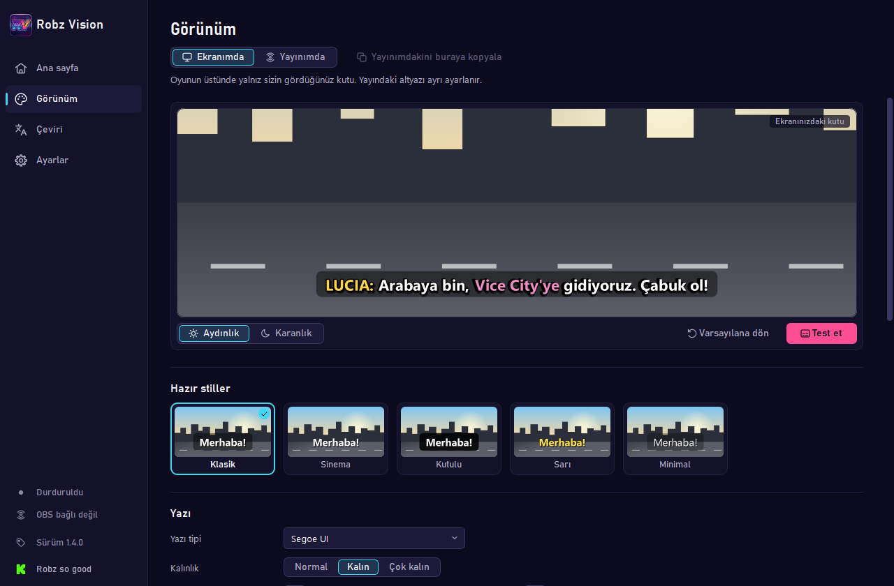

- **Hazır stiller:** Klasik, Sinema, Kutulu, Sarı, Minimal. Birini seçip üzerinde ince ayar yapabilirsiniz.
- **Yazı:** yazı tipi, kalınlık, boyut, renk.
- **Vurgulu kelimeler** ve **Vurgu rengi:** oyun görev yazısında bir yeri, kişiyi ya da eşyayı renkli yazarsa
  ("Drive to the **radar station**") çeviride de karşılığı renkli görünür ("**Radar istasyonuna** sür").
  Varsayılan renk GTA 6'nın pembesidir; dilediğiniz rengi seçebilirsiniz. Renkli kelimeyi en iyi yerel yapay
  zekâ ve Gemini taşır; hızlı yerel çeviride en iyi çabayla bulunur, DeepL'de vurgu yoktur.
- **Kenar ve gölge:** açık renkli sahnelerde kenarı kalınlaştırmak okumayı kolaylaştırır.
- **Arka plan:** *Yok*, *Yarı saydam* ya da *Opak* kutu.
- **Yerleşim → Oyun altyazısının üzerine** (iki tarafta ayrı, varsayılan kapalı): çeviri, oyunun İngilizce
  altyazısının tam yerine yazılır. Koyu, tamamen kapalı bir kutu İngilizce yazıyı örter; kutu altyazının
  genişliğindedir, Türkçe içinde ortalanır ve oyunun yazısıyla aynı boydadır. Türkçe sığmazsa yazı biraz küçülür,
  gerekirse ikinci satıra geçer ve kutu yukarı doğru büyür. Oyun altyazıyı kaldırınca kutu da kalkar. Açıkken o
  tarafın konum ayarları kullanılmaz (*Ekranımda* kutunun kaydettiğiniz yeri korunur, kapatınca oraya döner;
  *Yayınımda* OBS maskesi gerekmez, oyun görüntüsü OBS tuvalini tam kaplamalıdır). Kutunun rengi *Kutu rengi*'nden.
  Oyun bölgede aynı anda birden çok ayrı yazı gösterirse (ör. altta konuşma, üstünde daha küçük görev yazısı)
  her biri ayrı okunur ve çevrilir, her birinin üstüne kendi yerinde ve kendi boyunda ayrı bir kutu konur; en çok
  3 kutu. Biri kaybolunca yalnız onun kutusu kalkar. Yapay zekânın gördüğü önceki satırlara yalnız asıl yazı
  (en büyük yazılı olan, genellikle konuşma) girer. Örtme iki tarafta da kapalıyken okuma eskisi gibidir.
- **Ölçek** (yalnız *Ekranımda*): kutudaki yazıyı kenarı ve arka planıyla birlikte büyütür ya da küçültür.
  Kutunun yerini Ana sayfadaki **Konumu ayarla** belirler.
- **Konum ve genişlik** (yalnız *Yayınımda*): OBS'teki altyazının alt kenara uzaklığı ve en fazla genişliği.
- **Gelişmiş ayarlar:** konuşmacı adının rengi, belirme süresi, İngilizce orijinali çevirinin altında küçük
  gösterme. *Yayınımda*'da ayrıca OBS'te orijinali kapatma.

Seçimin yanındaki **Yayınımdakini buraya kopyala** (ya da **Ekranımdakini buraya kopyala**) öbür taraftaki
yazı, renk, kenar ve arka plan ayarlarını seçili tarafa aktarır; OBS'teki konum ve maske değişmez. İki taraf
zaten aynıysa düğme soluk görünür. **Varsayılana dön** yalnız seçili tarafı ilk hâline getirir.

## 7. Çeviriyi iyileştirin

**Çeviri** sayfasında çeviri motorunu ve sözlüğü ayarlarsınız.

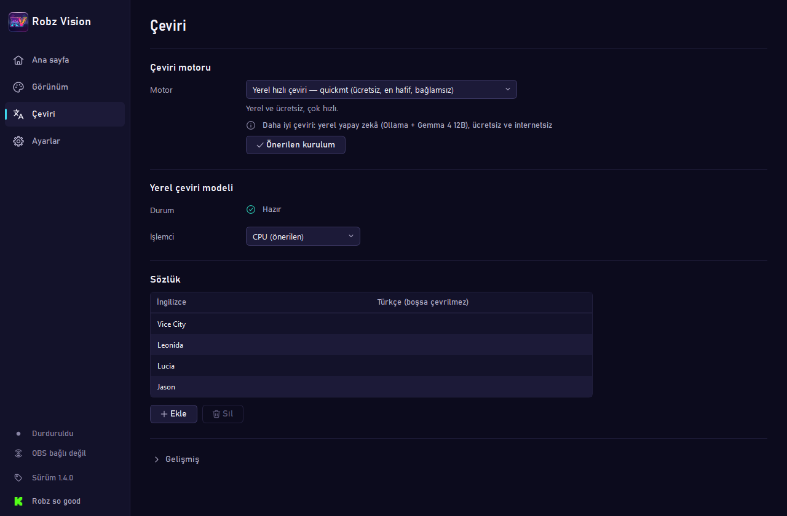

Varsayılan hızlı yerel çeviri (quickmt) her bilgisayarda çalışır ama satırları tek tek çevirir; bazen düz
ya da yanlış çevirir. Ekran kartınız varsa yerel yapay zekâyı kurun.

### Yerel yapay zekâ (önerilen)

Gemma 4, Ollama ile bilgisayarınızda çalışan bir dil modelidir.

- Ücretsizdir; internetsiz ve kotasız çalışır. Altyazılar bilgisayarınızdan çıkmaz.
- Önceki 8 satırı görür, cümleyi konuşmanın gidişatına göre çevirir.
- OCR'ın yanlış okuduğu harfleri düzeltir, tuş ipuçlarını ("Hold L2 to …") ayırır.
- En az 8 GB belleği olan bir NVIDIA ya da AMD ekran kartı ve Windows 10 22H2 ya da daha yenisi gerekir.
  12 GB'lık kartta Gemma 4 12B (`gemma4:12b`, 8,0 GB), 8 GB'lık kartta daha hafif Gemma 4 E4B (`gemma4:e4b`,
  6,6 GB) kurulur. 12 GB bellekli kartta satır başına yaklaşık 0,35 sn sürer.

Ollama'yı ayrıca kurmanız gerekmez; Robz Vision kendisi kurar. İlk açılışta *Yapay zekâ ile*'yi seçtiyseniz
kurulum zaten yapılır ([İlk açılış](#1-başlamadan-önce)). Sonradan kurmak için:

1. **Çeviri** sayfasında **Önerilen kurulum**'a basın. Düğme *Motor* seçiminin altındaki davette, motor
   Ollama'yken *Ollama* bölümündedir.
2. *Yapay zekâ kurulumu* penceresinde modeli, indirilecekleri ve boş disk alanını görürsünüz. **Kur**'a basın.
   Ollama yoksa önce o indirilip kurulur, sonra model iner. İkisi de kuruluysa pencere kendiliğinden kapanır,
   yalnız ayar yapılır.
3. İlerleme *Çeviri* sayfasında ve kenar çubuğundaki yapay zekâ satırında görünür; **İptal** ile
   durdurabilirsiniz. Bitince çeviri motoru yapay zekâya geçer.

Kurulum ilk açılıştaki gibi çalışır: çeviri çalışırken indirme durur, program kapanırsa sonraki açılışta
kaldığı yerden sürer. Listede olmayan bir Ollama modelini *Ollama* bölümünde adını yazıp **Modeli indir** ile
indirebilirsiniz.

**Ollama ayrı bir programdır.** Windows açılınca arka planda başlar; kapalıysa Robz Vision **Başlat**'ta onu
kendisi başlatır. Windows açılışında başlamasını istemiyorsanız *Görev Yöneticisi → Başlangıç uygulamaları*'ndan
kapatabilirsiniz. Ollama kendini de günceller: yeni sürümü (yaklaşık 1,9 GB) arka planda indirir, Windows
açılışında ya da görev çubuğundaki simgesinden *Restart to update* ile kurar. İndirmeyi istemiyorsanız
Ollama'nın ayarlarında *Auto-download updates*'i kapatın.

TranslateGemma artık önerilmiyor: önceki satırları (bağlamı) kullanmıyor. Kullanıyorsanız Gemma 4'e geçin.

### Çeviri ayarları

- **Hibrit mod** (*Yapay zekâ gecikirse hızlı çeviriyi göster*). Yapay zekânın çevirisi yaklaşık 1,2 sn
  içinde gelirse yalnız o görünür. Gecikirse önce hızlı yerel çeviri görünür, yapay zekânınki gelince aynı
  satırın üstüne yazılır. Bilgisayar bu süreye yetişemiyorsa satır hiç bekletilmez, hızlı çeviri hemen görünür.
  Kapalıyken her satırda yapay zekâ beklenir; hızlı çeviri yalnız model belleğe yüklenirken ya da yapay zekâ
  yanıt vermezse görünür. Yayın için açık bırakmanızı öneririz.
- **Bağlam.** Modelin gördüğü önceki satır sayısı; varsayılan 8.
- **Sözlük.** Çevrilmemesi gereken adları ekleyin: karakterler, mekânlar, çeteler, araç markaları. Türkçe
  sütunu boş bırakırsanız terim olduğu gibi kalır; doldurursanız o karşılık kullanılır. Varsayılan sözlükte
  Vice City, Leonida, Lucia ve Jason vardır.

Yapay zekâ her oyunda aynı, sade kurallarla çevirir: doğal Türkçe, kelimesi kelimesine değil. Özel isimler
(Vice City, Lucia, John) Türkçedeki kural gibi çevrilmez, ekleri kesme işaretiyle alır: Lucia'yı, Vice
City'de. Sözlükteki adlar her motorda, hızlı yerel çeviride de çevrilmeden kalır. Ollama'ya ulaşılamazsa ya
da bir hata olursa Robz Vision hızlı yerel çeviriyle devam eder.

### Çevrimiçi motorlar

Kendi API anahtarınızla Google Gemini ya da DeepL'i de seçebilirsiniz. Gemini'de önerilen model
*Gemini 3.5 Flash-Lite*. Daha güçlü Flash modellerinin ücretsiz kotası canlı yayında birkaç dakikada dolar.
Ücretsiz katmanın sınırlarını [Google AI Studio](https://aistudio.google.com/rate-limit)'da görebilirsiniz.
Kota dolunca hızlı yerel çeviri devam eder.

Gemini'nin ücretsiz katmanında gönderilen altyazı metinleri Google tarafından ürün geliştirmede
kullanılabilir. Bunu istemiyorsanız yerel motorlarda kalın.

## 8. Senaryolar

Oyunu nerede oynadığınıza göre dört yol var. Robz Vision her yolda **bilgisayarda** çalışır; televizyona ya da
konsola kurulmaz. Robz Vision'ı henüz kurmadıysanız önce
[README'deki rehberin 1. adımını](../README.md#1-robz-visionı-kurun) yapın.

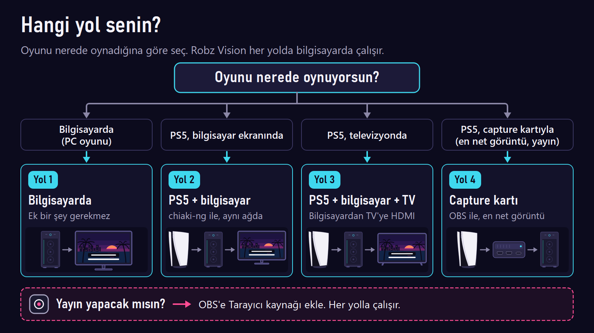

- **[Yol 1](#yol-1-bilgisayarda-oynuyorum):** oyun bilgisayarda.
- **[Yol 2](#yol-2-ps5i-bilgisayar-ekranında-oynuyorum):** PS5'i bilgisayar ekranında oynuyorsunuz.
- **[Yol 3](#yol-3-ps5i-televizyonda-oynuyorum):** PS5'i televizyonda oynuyorsunuz; bilgisayar TV'ye HDMI ile
  bağlı.
- **[Yol 4](#yol-4-capture-kartıyla-oynuyorum):** capture kartıyla; en net görüntü.
- Yayın yapacaksanız yolunuzu kurduktan sonra [Yayın yapıyorum](#yayın-yapıyorum) bölümüne geçin.

### Yol 1: Bilgisayarda oynuyorum

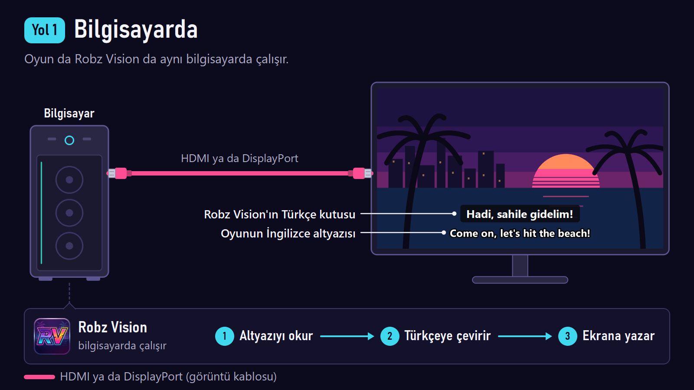

1. Oyunu *Pencereli tam ekran* modunda açın, İngilizce altyazıyı açın.
2. Robz Vision'da **Ekran** seçiliyken Ana sayfadaki canlı önizlemede altyazı alanını çizin (ilk açılışta
   alt-orta şerit seçili gelir; [Bölgeyi seçin](#2-bölgeyi-seçin)), **Başlat**'a basın.
3. **Konumu ayarla** ile kutuyu İngilizce altyazının hemen üstüne yerleştirin
   ([Türkçe kutuyu yerleştirin](#4-türkçe-kutuyu-ekranınıza-yerleştirin)).

OBS ile uğraşmanıza gerek yok. Oyun sırasında `Ctrl+Alt+H` ile çeviriyi gizleyip gösterebilirsiniz.

### Yol 2: PS5'i bilgisayar ekranında oynuyorum

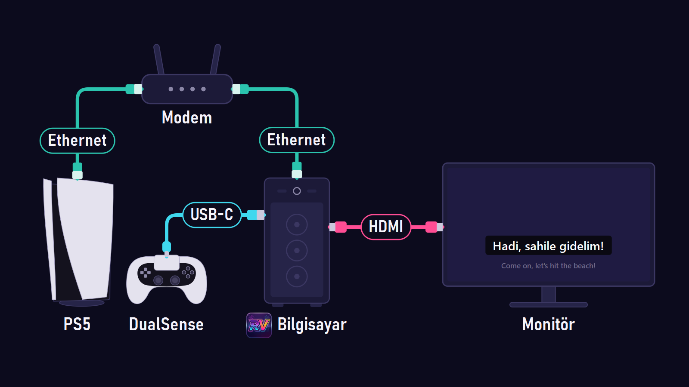

PS5 yerinde kalır; görüntüsü ev ağı üzerinden bilgisayara gelir, oyunu bilgisayardan oynarsınız. Burada
ücretsiz ve açık kaynak uzaktan oynatma programı chiaki-ng'i anlatıyoruz; Sony'nin resmî PS Remote Play
uygulaması da çalışır.

**PS5'te (bir kez)**

1. PS5'i Ethernet kablosuyla modeme bağlayın (önerilir). Bilgisayar da aynı modeme bağlı olsun, kabloyla ya da
   Wi-Fi ile.
2. *Ayarlar > Sistem > Uzaktan Oynama > Uzaktan Oynama'yı Etkinleştir*'i açın.
3. PS5'i dinlenme modundan bilgisayarla açabilmek için *Ayarlar > Sistem > Güç Tasarrufu > Dinlenme Modunda
   Kullanılabilen Özellikler*'de *İnternete Bağlı Kalın*'ı ve *PS5 Sisteminin Ağdan Açılmasını Etkinleştir*'i
   açın (isteğe bağlı).

**chiaki-ng'de (bir kez)**

4. chiaki-ng'i [GitHub sürüm sayfasından](https://github.com/chiaki-ng/chiaki-ng/releases/latest)
   (`chiaki-ng-win_x64-MSYS2-installer.exe`) ya da `winget install --id=StreetPea.chiaki-ng -e` ile kurun.
   Yalnız bu resmî kaynakları kullanın; chiaki-ng adını taşıyan başka siteler projenin değildir.
5. PS5 açık ya da dinlenme modundayken chiaki-ng'i açın; PS5 aynı ağdaysa listede kendiliğinden görünür.
   chiaki-ng'in istediği PlayStation Network girişini bir kez yapın ve ekrandaki yönergeye uyun.
6. PS5'in altında *Automatic Registration Available* yazıyorsa PS5'e tıklayıp onaylayın; kod gerekmez.
   Yazmıyorsa PS5'te *Ayarlar > Sistem > Uzaktan Oynama > Cihazı Eşleştir*'i seçin, ekranda çıkan sayıyı
   chiaki-ng'de *Remote Play PIN* alanına yazıp *Register*'a basın.
7. Sağ üstteki dişliden *Stream Settings* sekmesini açın; çözünürlüğü *1080p*, kare hızını *60 fps* yapın.
8. DualSense'i USB-C kabloyla (PS5'in kutusundan çıkan şarj kablosu) bilgisayara takın. Bluetooth için kolun
   **Oluştur** düğmesini basılı tutarken ışıklı çubuk yanıp sönene kadar **PS** düğmesini basılı tutun, sonra
   Windows'un Bluetooth ayarlarında kolu seçin. Kolu yeniden PS5'te kullanmak için USB kabloyla PS5'e takıp PS
   düğmesine basın.

**Her oynayışta**

9. chiaki-ng'de PS5'e tıklayın; görüntü bir pencerede açılır. Pencereyi büyütün ya da tam ekran yapın.
10. Robz Vision'da **Uygulama penceresi**'ni seçin, listeden chiaki-ng'in oyun penceresini seçin. Önizlemede
    o pencerenin görüntüsü belirir; altyazı alanını üstünde fareyle çizin ([Bölgeyi seçin](#2-bölgeyi-seçin)).
    Pencereyi tam ekran kullanıyorsanız **Ekran** da olur.
11. **Başlat**'a basın ve kutuyu yerleştirin.

Uzaktan oynatma görüntüsü sıkıştırıldığı için altyazı bulanık olabilir. Okumalar bozuksa PS5'i modeme kabloyla
bağlayın, uygulamanın görüntü kalitesini yükseltin (chiaki-ng'de 1080p ve 60 fps) ya da oyunda altyazı boyutunu
büyütün. chiaki-ng'in penceresi boş kalırsa Başlat menüsünden *chiaki-ng (OpenGL)*'i açın.

PS Remote Play kullanacaksanız 4–7. adımlar yerine onu kurun. Xbox'ta aynı yolu Xbox uygulamasıyla izlersiniz:
konsolu bilgisayarda açıp Robz Vision'da onun penceresini seçin.

### Yol 3: PS5'i televizyonda oynuyorum

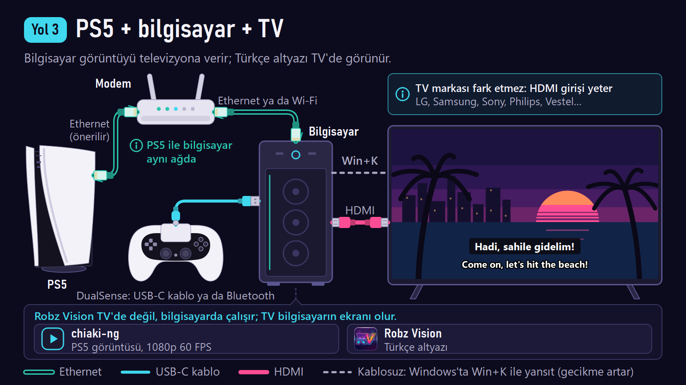

Robz Vision televizyonun kendisinde çalışamaz: TV uygulamaları HDMI'dan gelen konsol görüntüsünü okuyamaz.
Bilgisayarı TV'ye bağlarsınız; TV bilgisayarın ekranı olur, Türkçe kutu TV'de oyunun üstünde görünür. TV'nin
markası fark etmez, HDMI girişi olması yeter.

1. [Yol 2](#yol-2-ps5i-bilgisayar-ekranında-oynuyorum)'nin 1–8. adımlarını yapın.
2. HDMI kablonun bir ucunu bilgisayarın HDMI çıkışına (masaüstü bilgisayarda ekran kartının üstündeki
   çıkışa), öbür ucunu TV'nin HDMI girişine takın.
3. TV'nin kumandasında *Kaynak*, *Source* ya da *Input* düğmesiyle kabloyu taktığınız HDMI girişini seçin.
4. Bilgisayarda *Win+P*'ye basın: *Yalnızca ikinci ekran* görüntüyü yalnız TV'ye verir, *Çoğalt* monitörde ve
   TV'de aynı görüntüyü gösterir.
5. TV'de *Oyun modu*nu açarsanız gecikme azalır. Adı ve yeri markaya göre değişir.
6. chiaki-ng penceresini TV'de tam ekran yapın, sonra Yol 2'nin 9–11. adımlarını yapın.

**Monitör de açık kalsın isterseniz** *Win+P*'de *Genişlet*'i seçin: chiaki-ng penceresini TV'ye taşıyın,
Robz Vision monitörde kalsın. **Ekran** modunda önizlemenin üstündeki listeden TV'yi seçip bölgeyi onun
görüntüsünde çizin ya da **Tam ekranda seç** ile doğrudan TV'de çizin (seçici bütün ekranlarda açılır). Türkçe
kutuyu *Ekranımda → Konumu ayarla* ile TV ekranına sürükleyin.

**Kablo yerine kablosuz.** TV'niz kablosuz ekran yansıtmayı (Miracast) destekliyorsa bilgisayarda *Win+K*'ye
basıp listeden TV'yi seçin (LG'de *Screen Share*). Gecikme artar; hikâye oyunlarında genelde sorun olmaz.
Türkçe kutu TV'de görünmezse Ana sayfada **Yayında da görünsün**'ü açın; kutu okunan bölgenin üstüne gelirse
Robz Vision uyarır, kutuyu biraz kaydırın.

### Yol 4: Capture kartıyla oynuyorum

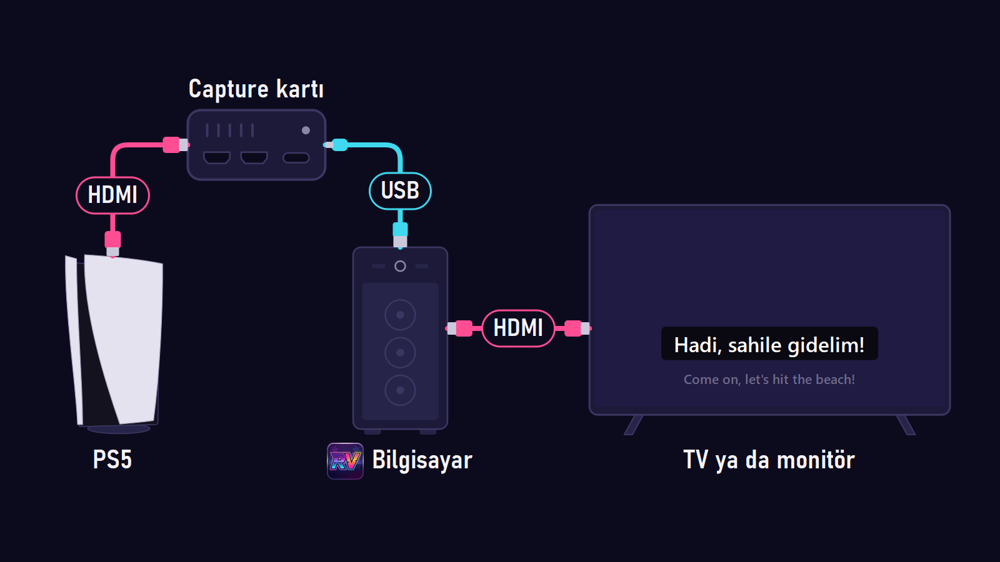

Remote Play sıkıştırması olmadığı için altyazı en net bu yolda okunur. Kol PS5'e her zamanki gibi bağlı kalır.
Robz Vision'ın OBS önizlemesini değil, ham oyun görüntüsünü okuması gerekir; OBS önizlemesinde Türkçe altyazı
da vardır.

1. PS5'te *Ayarlar → Sistem → HDMI → HDCP'yi Etkinleştir*'i kapatın; açıkken kart görüntüyü alamaz.
2. PS5'in HDMI çıkışını capture kartının HDMI girişine, kartı USB ile bilgisayara takın. TV ya da monitör
   bilgisayara bağlı kalır.
3. Kartı OBS'e kaynak olarak ekleyin. OBS'te capture kartı kaynağına sağ tıklayıp
   **Pencereli Projektör (Kaynak)**'ı açın. Bu pencere yalnızca oyun görüntüsünü gösterir; oyunu bu pencereden
   oynarsınız. Kartın kendi önizleme uygulaması da olur.
4. Robz Vision'da **Uygulama penceresi** ile bu projektör penceresini seçin; önizlemede pencerenin görüntüsü
   belirir, altyazı alanını üstünde çizin. Projektör penceresi başka pencerelerin arkasında kalabilir, ama simge
   durumuna küçültülmemeli.
5. **Başlat**'a basın ve kutuyu yerleştirin.
6. Yayın yapıyorsanız Ana sayfadaki adresi OBS'e **Tarayıcı** kaynağı olarak ekleyin ve capture kartı
   kaynağının üstüne taşıyın. İsterseniz *Görünüm → Yayınımda → Gelişmiş ayarlar → OBS'te orijinali kapat* ile
   İngilizce altyazıyı yayında gizleyin.

**Kartın kendi HDMI çıkışı (passthrough).** Bazı kartların TV'ye giden düşük gecikmeli bir çıkışı vardır. Bu
görüntü bilgisayardan geçmez, orada çeviri görünmez. Kendiniz oyunu televizyondan ya da kartın bu çıkışından
oynuyorsanız Türkçeyi bilgisayarın ekranında okursunuz. Ekrandaki kutuyu kapatabilirsiniz
(**Ekranımda → Kapalı**); çeviriyi OBS önizlemesinde görürsünüz.

### Yayın yapıyorum

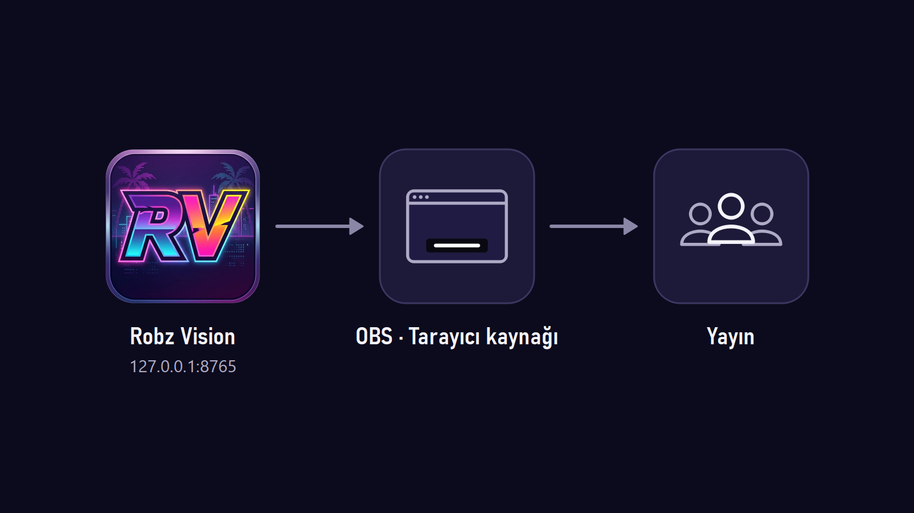

Yolunuz hangisi olursa olsun yayın aynıdır:

1. Oyun görüntüsünü OBS'e her zamanki gibi ekleyin: PC oyununu *Oyun Yakalama* ya da *Ekran Yakalama* ile,
   PS5'i chiaki-ng penceresi ya da capture kartı kaynağı olarak.
2. Robz Vision'da bölgeyi seçin, **Başlat**'a basın, kendi kutunuzu yerleştirin.
3. İzleyiciler için Ana sayfadaki adresi **Tarayıcı** kaynağı olarak ekleyin ve oyun görüntüsünün üstüne
   taşıyın ([OBS'e ekleyin](#5-obse-ekleyin)). İzleyiciler Kick, Twitch ya da YouTube'da Türkçe altyazıyı görür.

Ekrandaki kutu varsayılan olarak yayına girmez, izleyiciler altyazıyı iki kez görmez. Tarayıcı kaynağı
yerine ekrandaki kutuyu yayında göstermek isterseniz *Ekran Yakalama* kullanın ve **Yayında da görünsün**'ü
açın. *Oyun Yakalama* bu kutuyu hiçbir durumda göstermez.

### İzleyiciyim

Hiçbir şey kurmanız gerekmez; altyazı yayının parçasıdır. Yazı küçük ya da okunaksızsa yayıncıya
*Görünüm* sayfasından boyutu ve arka planı ayarlamasını önerin.

## 9. Kısayollar

| Kısayol | İşlev |
|---|---|
| `Ctrl+Alt+T` | Başlat / durdur |
| `Ctrl+Alt+H` | Çeviriyi gizle / göster |
| `Ctrl+Alt+C` | Ekrandaki çeviriyi temizle |

Kısayollar oyun ön plandayken de çalışır. Başka bir programla çakışırsa *Ayarlar → Kısayollar*'dan
değiştirip **Kaydet**'e basın.

## 10. Sorun giderme

**Ollama'ya ulaşılamıyor ya da model yüklü değil.** Robz Vision bu sırada hızlı yerel çeviriyle devam eder ve
hata penceresi yerine bir bildirim gösterir (ör. *Gemma 4 12B hazırlanamadı; hızlı çeviri kullanılıyor.*).

- Ollama kapalıysa Robz Vision **Başlat**'ta onu kendisi başlatır. Başlatamazsa Ollama'yı Başlat
  menüsünden açın.
- *Çeviri* sayfasının *Ollama* bölümündeki adres `http://127.0.0.1:11434` olmalı. Ollama'yı başka bir
  adreste çalıştırıyorsanız aşağıdaki *Ollama başka bir adreste* maddesine bakın.
- Model indirilmemişse ya da indirme yarıda kaldıysa **Önerilen kurulum**'a yeniden basın; inmiş kısım
  yeniden inmez.

**Çeviri gecikiyor.** Ekranda önce hızlı çeviri görünüp sık sık sonradan değişiyorsa yapay zekâ yetişemiyor
demektir. Daha küçük bir model seçin: *Ollama* bölümünde modeli `gemma4:e4b` yapıp **Modeli indir**'e basın.

**Bazı altyazılar çevrilmiyor.** Oyunun altyazısı renkli, kenarsız ya da sola dayalıysa *Ayarlar → Metin
okuma → Yalnız altyazıları oku*'yu kapatın.

**Ekran kartının belleği (VRAM) yetmiyor.** `gemma4:12b` 12 GB bellekli kartta rahat çalışır. Bellek
yetmezse Ollama modelin bir kısmını işlemcide çalıştırır ve çeviri yavaşlar.

- `gemma4:e4b`'yi seçin.
- Ekran kartını kullanan diğer programları kapatın. PC'de oynuyorsanız oyun da ekran kartının belleğini
  kullanır.
- Modelin nerede çalıştığını görmek için komut isteminde `ollama ps` yazın. *PROCESSOR* sütununda
  `100% GPU` görmelisiniz; CPU payı varsa bellek yetmiyordur.

**Çeviri, İngilizce altyazı ekrandayken kayboluyor.** Her satır en fazla *En uzun kalma* süresi kadar
görünür (varsayılan 7 sn). Uzun altyazılı sahnelerde *Ayarlar → Altyazı akışı → En uzun kalma*'yı artırın.

### Yapay zekâ kurulumu

Kurulum bir adımda takılırsa ilerleme listesinde o satır kırmızı olur ve altında kısa nedeni yazar; ayrıntısı
**Tekrar dene**'nin ipucundadır. Hızlı çeviri bu sırada çalışmaya devam eder. Ollama kurulumunun günlüğü:
`%LOCALAPPDATA%\RobzVision\Logs\ollama-kurulum.log`.

**İnternet kesildi.** *İnternet bağlantısı yok. Bağlantı gelince kaldığı yerden sürer.* Robz Vision 5, 15 ve
45 saniye arayla yeniden dener. Bağlantı yine gelmezse kurulum durur; bağlantı gelince **Tekrar dene**'ye
basın. İnmiş kısım silinmez: Ollama'nın kurulum dosyası da model de kaldığı yerden iner.

**Diskte yer yetmiyor.** Onay penceresi kurulumdan önce boş yere bakar. Yer yetmiyorsa *C: sürücüsünde yer
yetmiyor: 9 GB boş, ~15 GB gerekli* gibi bir satır çıkar ve **Kur** kapalı kalır. Kurulum sürerken disk
dolarsa *Diskte yer kalmadı (C:). Yer açıp Tekrar dene'ye basın.* yazar. Gemma 4 12B ile kurulum sırasında
yaklaşık 15 GB boş yer gerekir.

- Ollama ve geçici kurulum dosyası `%LOCALAPPDATA%` sürücüsüne (genelde C:), modeller
  `%USERPROFILE%\.ollama\models` klasörüne iner.
- Modelleri başka bir sürücüde tutmak için kullanıcı ortam değişkenlerine `OLLAMA_MODELS` ekleyin
  (ör. `D:\ollama\models`), sonra Ollama'yı ve Robz Vision'ı yeniden başlatın. Disk denetimi de o sürücüye
  bakar.

**Antivirüs ya da şirket ilkesi engelledi.** *Ollama kurulumu engellendi.* Antivirüs programınız ya da
bilgisayardaki şirket ilkesi (AppLocker, WDAC) Ollama'nın kurulum dosyasını durdurmuş olabilir. Robz Vision'ın
çalıştırdığı dosya, Ollama'nın GitHub'daki resmî ve imzalı kurulum dosyasıdır; çalıştırılmadan önce SHA256
özeti ve imzası denetlenir. **Ollama'yı elle kur** bağlantısıyla Ollama'yı sitesinden
([ollama.com/download](https://ollama.com/download)) indirip kendiniz kurun, sonra **Tekrar dene**'ye basın:
Robz Vision kurulu Ollama'yı bulur, yalnız modeli indirir. Şirket bilgisayarında BT yöneticinize danışın.

**İmza doğrulanamadı.** *Ollama dosyasının imzası doğrulanamadı; kurulmadı.* Robz Vision, Ollama'nın kurulum
dosyasını çalıştırmadan önce dijital imzasına bakar: imza geçerli ve Ollama Inc. adına olmalıdır. Değilse
dosya silinir ve hiçbir şey kurulmaz. **Ollama'yı elle kur** bağlantısıyla Ollama'yı sitesinden indirip
kendiniz kurun, sonra **Tekrar dene**'ye basın. Sorun sürerse günlük dosyasıyla bir hata kaydı açın.

**Ollama ekran kartınızı kullanamıyor.** Ollama yalnız işlemciyi ya da tümleşik kartı görüyorsa model
indirilmez; yapay zekâ işlemcide çok yavaş çalışırdı. Ekran kartı sürücüsünü güncelleyin (NVIDIA'da en az
551.61) ve **Tekrar dene**'ye basın.

**11434 portunu başka bir program kullanıyor.** Ollama'nın portunda başka bir program çalıştığı için kurulum
başlamaz; onay penceresinde **Kur** kapalı kalır. O programı kapatıp yeniden deneyin.

**Ollama başka bir adreste (`OLLAMA_HOST`).** Ollama'yı `OLLAMA_HOST` ortam değişkeniyle başka bir portta
çalıştırıyorsanız (ör. `127.0.0.1:11500`) Robz Vision bu değişkeni okur ve Ollama'yı orada bulur; kurulum
bitince *Çeviri* sayfasındaki adres de buna göre ayarlanır. Değişkeni Robz Vision açıkken tanımladıysanız da
okunur. Kurulum yalnız bu bilgisayardaki Ollama'yla çalışır. Başka bir bilgisayardaki Ollama'yı kullanmak için
modeli o bilgisayarda indirin ve adresini *Çeviri* sayfasının *Ollama* bölümüne yazın.

### Güncellemeler

Robz Vision açıkken yeni bir sürüm çıkıp çıkmadığına kendisi bakar: açılıştan kısa süre sonra ve sonra saatte
bir GitHub'a kısa bir istek gönderir. Yalnız son sürümün numarası okunur, kişisel bilgi gönderilmez. Yeni sürüm
varsa kenar çubuğunda **Güncelleme var** satırı belirir ve bir kez kısa bir bildirim çıkar. Çeviri çalışırken
bildirim beklenir; yayınınıza tepsi balonu düşmez. Satıra ya da bildirime tıklayınca neler yeni olduğunu
görürsünüz:

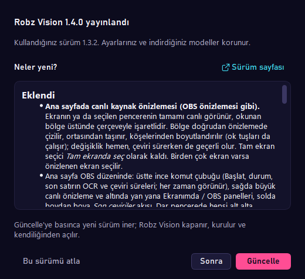

- **Güncelle:** yeni sürüm iner ve doğrulanır. Boyutu ve SHA256 özeti GitHub'daki sürüm kaydıyla
  karşılaştırılır; tutmazsa dosya silinir, çalıştırılmaz. Sonra Robz Vision kapanır, yeni sürüm kurulur ve
  kendiliğinden açılır. Çeviri çalışıyorsa önce sorar.
- **Sonra:** pencere kapanır; kenar çubuğundaki satır kalır, sonraki açılışta yine hatırlatılır.
- **Bu sürümü atla:** bu sürüm bir daha bildirilmez; daha yeni bir sürüm çıkınca yine bildirilir.

**Ayarlarınız korunur.** Güncelleme yalnız program klasörünü değiştirir; ayarlara (`%APPDATA%\RobzVision`),
indirilen modellere ve Ollama'ya dokunmaz. Kurulumdan önce ayar dosyası aynı klasöre
`ayarlar.yedek-<eski sürüm>.json` adıyla yedeklenir (son üç yedek kalır). Masaüstü kısayolunu sildiyseniz
güncelleme onu geri getirmez.

**Taşınabilir sürüm** kendini güncelleyemez: **İndir** sürüm sayfasını tarayıcıda açar; yeni sürümü eski
klasörün yerine çıkarın, ayarlarınız yine korunur. Robz Vision'ı tüm kullanıcılar için kurduysanız da yeni
sürümü indirip kendiniz kurun.

Denetimi *Ayarlar → Uygulama → Güncellemeler*'den kapatabilir, **Şimdi denetle** ile elle bakabilirsiniz
(atladığınız sürüm de gösterilir). Uygulama içinden güncelleme 1.3.0'dan sonraki sürümle geldi; 1.3.0 ve
öncesini bir kez elle güncellemeniz gerekir.

### Kaldırma

Robz Vision'ı *Ayarlar → Uygulamalar*'dan kaldırırsınız. Program dosyaları ve indirilmiş Ollama kurulum
dosyası (`%LOCALAPPDATA%\RobzVision\indirilenler`) silinir. Ayarlar (`%APPDATA%\RobzVision`) ve hızlı çeviri
modeli (`%LOCALAPPDATA%\RobzVision`) yeniden kurulumda tekrar inmesin diye kalır; isterseniz elle
silebilirsiniz.

**Robz Vision kaldırılınca Ollama kalır.** Ollama ayrı bir programdır; başka programlar da kullanabilir.
Ollama'yı da kaldırmak isterseniz *Ayarlar → Uygulamalar*'da *Ollama*'yı bulup kaldırın. Ollama'nın kaldırıcısı
modelleri de silmeyi önerir (*Remove models* kutusu). Modeller `%USERPROFILE%\.ollama\models` klasöründedir
(Gemma 4 12B yaklaşık 8 GB); kaldırıcı silmediyse bu klasörü elle silebilirsiniz.

---

Başka bir sorun mu yaşıyorsunuz? Önce [README'deki SSS](../README.md#sss-ve-sorun-giderme) bölümüne bakın.
Çözülmezse günlük dosyasıyla birlikte (`%LOCALAPPDATA%\RobzVision\Logs`) bir hata kaydı açın:
[CONTRIBUTING.md](../CONTRIBUTING.md#hata-bildirmek).

Robz Vision'ı Kick yayıncısı Robz so good geliştiriyor; güncellemeler yayınlarda duyurulur:
<a href="https://kick.com/robzsogood"> kick.com/robzsogood</a>
