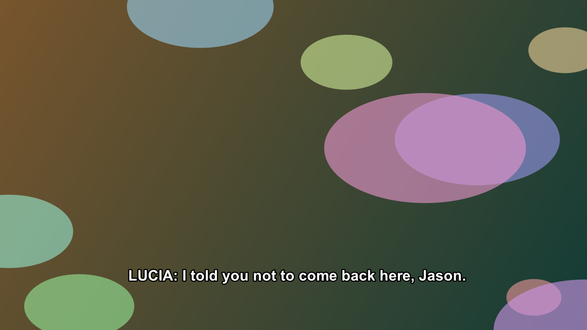
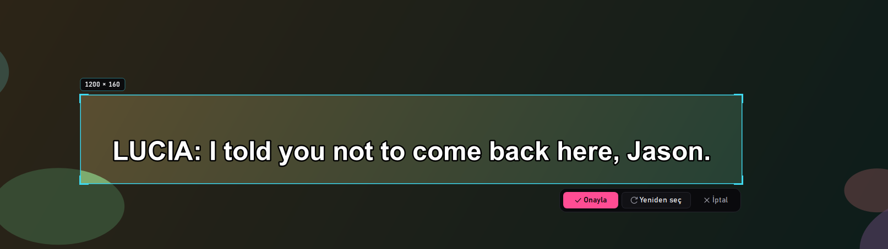
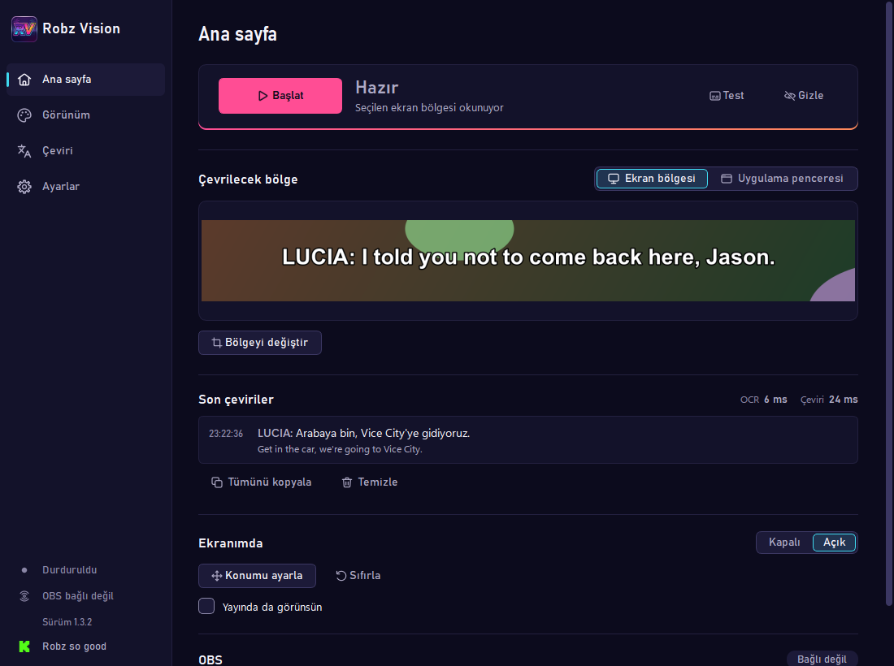
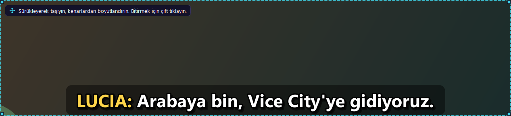

# Robz Vision kullanım kılavuzu

Bu kılavuz, Robz Vision'ı ilk kez kuran birinin oyunda Türkçe altyazı görene kadar yapacağı her adımı
anlatır. Sonda tek başına oynayanlar, konsol oyuncuları ve yayıncılar için ayrı ipuçları var.

Kurulum için [README'deki Kurulum bölümüne](../README.md#kurulum) bakın.

| Oyunun kendi altyazısı | Robz Vision açıkken |
|---|---|
|  |  |

Görüntüler depodaki sahte test sahnesinden (`tools/test_penceresi.py`) alınmıştır.

## İçindekiler

1. [Başlamadan önce](#1-başlamadan-önce)
2. [Bölgeyi seçin](#2-bölgeyi-seçin)
3. [Başlatın](#3-başlatın)
4. [Türkçe kutuyu ekranınıza yerleştirin](#4-türkçe-kutuyu-ekranınıza-yerleştirin)
5. [OBS'e ekleyin](#5-obse-ekleyin)
6. [Görünümü ayarlayın](#6-görünümü-ayarlayın)
7. [Çeviriyi iyileştirin](#7-çeviriyi-iyileştirin)
8. [Senaryolar](#8-senaryolar)
9. [Kısayollar](#9-kısayollar)

## 1. Başlamadan önce

**Oyun görüntüsü bilgisayar ekranında olmalı.** Robz Vision Windows'ta çalışır ve ekranda gördüğünü okur.
PC'de oynuyorsanız ek bir şey gerekmez. Konsolda oynuyorsanız görüntüyü bilgisayara şu yollardan biriyle
getirin:

- **PS Remote Play** ya da **Xbox uygulaması** ile konsolu bilgisayardan oynatın.
- **Capture kartının** görüntüsünü bir pencerede açın: kartın kendi uygulaması ya da OBS'in
  *Pencereli Projektör (Kaynak)* penceresi. Ayrıntılar [Senaryolar](#8-senaryolar) bölümünde.

**Oyunda İngilizce altyazıyı açın.** Robz Vision ses dinlemez, yalnızca ekrandaki yazıyı okur.
Altyazı ne kadar okunaklıysa (büyük, kenarlı ya da arka planlı) sonuç o kadar iyi olur.

**İlk açılış.** Program ilk açıldığında ücretsiz çeviri modelini (yaklaşık 400 MB) bir kez indirir. Sonra
kısa bir tanıtım turu arayüzün bölümlerini gösterir. Turu atlarsanız *Ayarlar → Tanıtım turunu başlat* ile
istediğiniz zaman yeniden açabilirsiniz.

## 2. Bölgeyi seçin

Ana sayfadaki **Çevrilecek bölge** bölümünde iki yol var:

- **Ekran bölgesi** (önerilen): Ekranın herhangi bir yerini fareyle seçersiniz.
- **Uygulama penceresi:** Listeden bir pencere seçer, sonra o pencerenin içinde altyazı alanını
  işaretlersiniz. Pencere başka pencerelerin arkasında kalsa da okunur, ama simge durumuna küçültülmemeli.
  Oyunu ikinci ekranda ya da başka pencerelerin arkasında tutuyorsanız bu yolu seçin.

**Bölge seç**'e bastığınızda ekran kararır, oyun arkada akmaya devam eder. Altyazının çıktığı alanı fareyle
çizin ve **Onayla**'ya basın.

İyi bir bölge için:

- Altyazının en uzun ve en çok satırlı hâlini kapsayın; iki satırlık altyazılara yer bırakın.
- Mini harita, görev yazısı, para göstergesi gibi arayüz öğelerini dışarıda bırakın. Bırakamıyorsanız
  *Ayarlar → Metin okuma → Gelişmiş → Yalnızca en alttaki satırları oku* açık kalsın.
- Bölgeyi gereğinden büyük tutmayın. Küçük bölge hem daha hızlı hem daha doğru okunur.

Seçtiğiniz bölgenin canlı görüntüsü Ana sayfada görünür. Program çalışırken metin olarak algılanan yerler
yeşile boyanır; altyazı geldiğinde yeşil alan görünmüyorsa bölge ya da eşik ayarı yanlıştır.

## 3. Başlatın

**Başlat**'a basın. Üstteki bant *Çalışıyor* olur. Oyunda altyazı belirince Türkçesi ekrandaki kutuda ve
OBS'te görünür. **Son çeviri** bölümü okunan İngilizce metni, çeviriyi ve OCR ile çeviri sürelerini gösterir.

- **Test** düğmesi ekranınızda ve OBS'te 5 saniyelik örnek bir altyazı gösterir. Oyun açmadan görünümü
  denemek için kullanın.
- **Gizle** çeviriyi geçici olarak gizler; program okumaya devam eder.

## 4. Türkçe kutuyu ekranınıza yerleştirin

Ana sayfadaki **Ekranımda** bölümü kendi ekranınızdaki altyazı kutusunu yönetir.

1. **Ekranımda**'yı **Açık** yapın.
2. **Konumu ayarla**'ya basın. Kutu, gerçek görünümüyle ve bir örnek cümleyle belirir.
3. Kutuyu sürükleyerek taşıyın, kenarlarından boyutlandırın.
4. Bitirmek için kutuya çift tıklayın ya da **Konumu kaydet**'e basın.

Konum ipuçları:

- En rahat yer, oyunun İngilizce altyazısının hemen üstüdür; gözünüz iki satır arasında gidip gelmez.
- Kutu, okunan bölgenin üstüne gelse bile sorun olmaz. Kutu ekran yakalamaya girmez, bu yüzden Robz Vision
  kendi Türkçe yazısını okumaz.
- **Sıfırla** kutuyu varsayılan konumuna döndürür. Yazı boyutunu yalnız ekranınız için büyütüp küçültmek
  isterseniz *Görünüm → Konum ve ölçek → Ekranımda ölçek*'i kullanın.
- Kutu oyunun üstünde görünmüyorsa oyunu *Pencereli tam ekran* (kenarlıksız) modunda çalıştırın.

**Yayında da görünsün** seçeneği kutuyu ekran yakalamaya açar. Yalnızca OBS'te *Ekran Yakalama* ile yayın
yapıyor ve tarayıcı kaynağı kullanmak istemiyorsanız açın. Bu seçenek açıkken kutu okunan bölgenin üstüne
gelirse Robz Vision *Kutu okunan bölgenin üstünde* uyarısı verir; kutuyu bölgenin dışına taşıyın.

## 5. OBS'e ekleyin

İzleyicilerinizin de Türkçe altyazı görmesi için Ana sayfanın **OBS** bölümündeki adresi OBS'e ekleyin.
Adresin yanındaki soru işareti düğmesi aynı adımları uygulama içinde gösterir.

1. OBS'te **Kaynaklar** altındaki **+** düğmesine basıp **Tarayıcı**'yı seçin.
2. **Yerel dosya** kutusunu boş bırakın, **URL** alanına Ana sayfadaki adresi yapıştırın
   (varsayılan: `http://127.0.0.1:8765/`).
3. Genişlik ve yüksekliği tuvalle aynı yapın, örneğin 1920 × 1080. Varsayılan 800 × 600'de bırakırsanız
   altyazı küçük ve tuvalin sol üstünde kalır.
4. Kaynağı listede oyun görüntüsünün üstüne taşıyın.

Bağlantı kurulunca Ana sayfada ve kenar çubuğunda *OBS bağlı* yazar. Yalnızca OBS'teki kaynak sayılır; adresi
bir web tarayıcısında açmak bu yazıyı değiştirmez. Görünüm değişiklikleri OBS'e anında yansır; kaynağı
yeniden yüklemeniz gerekmez.

**OBS'te altyazı çıkmıyor, tarayıcıda çıkıyorsa:** OBS'i Robz Vision'dan önce açtıysanız tarayıcı kaynağı
sayfayı yükleyemez ve OBS bunu kendiliğinden yeniden denemez; kaynak boş kalır. OBS'te kaynağı seçip
önizlemenin altındaki **Yenile**'ye basın (ya da kaynağa çift tıklayıp *Geçerli sayfanın önbelleğini
yenile*'ye basın). Kaynak bir kez yüklendikten sonra OBS sayfanın kopyasını saklar; sonraki açılışlarda
hangisini önce açtığınız fark etmez, Robz Vision açılınca altyazı kendiliğinden gelir.

Bilmeniz gerekenler:

- Adres yalnızca aynı bilgisayarda çalışır. İki bilgisayarlı yayın düzeninde Robz Vision'ı OBS'in çalıştığı
  bilgisayara kurun.
- OBS'teki altyazının yeri ve genişliği ekrandaki kutudan bağımsızdır: *Görünüm → Konum ve ölçek →
  OBS'te alttan* ve *OBS'te genişlik*.
- İzleyiciler İngilizce ve Türkçe altyazıyı üst üste görmesin istiyorsanız *Görünüm → Gelişmiş ayarlar →
  OBS'te orijinali kapat*'ı açın. Robz Vision, seçtiğiniz bölgenin üstüne yalnızca OBS'te bir kutu koyar.
  Oyun görüntüsü OBS tuvalini tam kaplıyorsa kutu birebir oturur.
- Port başka bir programla çakışırsa *Ayarlar → OBS → Port*'tan değiştirip uygulamayı yeniden başlatın,
  OBS'teki adresi de güncelleyin.

## 6. Görünümü ayarlayın

**Görünüm** sayfasındaki her değişiklik hem ekrandaki kutuya hem OBS'e anında yansır. Üstteki önizleme 1080p
bir yayının oranındadır; *Aydınlık* ve *Karanlık* arka planlarla yazının iki durumda da okunduğunu kontrol
edin.

- **Hazır stiller:** Klasik, Sinema, Kutulu, Sarı, Minimal. Birini seçip üzerinde ince ayar yapabilirsiniz.
- **Yazı:** yazı tipi, kalınlık, boyut, renk.
- **Kenar ve gölge:** açık renkli sahnelerde kenarı kalınlaştırmak okumayı kolaylaştırır.
- **Arka plan:** *Yok*, *Yarı saydam* ya da *Opak* kutu.
- **Gelişmiş ayarlar:** konuşmacı adının rengi, belirme süresi, İngilizce orijinali çevirinin altında küçük
  gösterme ve OBS'te orijinali kapatma.

**Varsayılana dön** tüm görünüm ayarlarını ilk hâline getirir.

## 7. Çeviriyi iyileştirin

**Çeviri** sayfasında motoru ve sözlüğü ayarlarsınız.

- **Sözlük.** Çevrilmemesi gereken adları ekleyin: karakterler, mekânlar, çeteler, araç markaları. Türkçe
  sütunu boş bırakırsanız terim olduğu gibi kalır; doldurursanız o karşılık kullanılır. Varsayılan sözlükte
  Vice City, Leonida, Lucia ve Jason vardır.
- **Daha iyi çeviri.** Yerel model hızlıdır ama bazen düz çevirir. Ekran kartınız varsa Ollama ile
  TranslateGemma'yı deneyin. Kendi anahtarınızla Gemini ya da DeepL de seçebilirsiniz. Bu motorlarda önce
  yerel çeviri görünür, daha iyi sonuç gelince yerine geçer (*Hibrit mod*).
- **Oyun bağlamı.** Dil modeli motorlarında *Oyun bağlamı* alanına kısa bir not yazın
  (ör. "GTA VI, suç dünyası, argo"). Model üslubu buna göre seçer.

*Hibrit mod*, *Bağlam* ve *Oyun bağlamı* yalnızca Ollama, Gemini ya da DeepL seçiliyken motor seçiminin
altında görünür.

Gemini'nin ücretsiz katmanında gönderilen altyazı metinleri Google tarafından ürün geliştirmede
kullanılabilir. Bunu istemiyorsanız yerel motorlarda kalın.

## 8. Senaryolar

### PC'de tek başıma oynuyorum

1. Oyunu *Pencereli tam ekran* modunda açın, İngilizce altyazıyı açın.
2. Robz Vision'da **Ekran bölgesi** ile altyazı alanını seçin, **Başlat**'a basın.
3. **Konumu ayarla** ile kutuyu İngilizce altyazının hemen üstüne yerleştirin.

OBS ile uğraşmanıza gerek yok. Oyun sırasında `Ctrl+Alt+H` ile çeviriyi gizleyip gösterebilirsiniz.

### Konsolda oynuyorum (uzaktan oynatma)

1. PS Remote Play ya da Xbox uygulamasıyla konsolu bilgisayarda açın.
2. Robz Vision'da **Uygulama penceresi**'ni seçin, listeden uzaktan oynatma penceresini seçip altyazı alanını
   işaretleyin. Pencereyi tam ekran kullanıyorsanız **Ekran bölgesi** de olur.
3. **Başlat**'a basın ve kutuyu yerleştirin.

Uzaktan oynatma görüntüsü sıkıştırıldığı için altyazı bulanık olabilir. Okumalar bozuksa uygulamanın
görüntü kalitesini yükseltin ya da oyunda altyazı boyutunu büyütün.

### Konsoldan capture kartıyla yayın yapıyorum

Robz Vision'ın OBS önizlemesini değil, ham oyun görüntüsünü okuması gerekir; önizlemede Türkçe altyazı da
vardır.

1. OBS'te capture kartı kaynağına sağ tıklayıp **Pencereli Projektör (Kaynak)**'ı açın. Bu pencere yalnızca
   oyun görüntüsünü gösterir.
2. Robz Vision'da **Uygulama penceresi** ile bu projektör penceresini seçin ve altyazı alanını işaretleyin.
   Projektör penceresi başka pencerelerin arkasında kalabilir, ama simge durumuna küçültülmemeli.
3. Ana sayfadaki adresi OBS'e **Tarayıcı** kaynağı olarak ekleyin ve capture kartı kaynağının üstüne taşıyın.
4. İsterseniz *Görünüm → Gelişmiş ayarlar → OBS'te orijinali kapat* ile İngilizce altyazıyı yayında gizleyin.

Kendiniz oyunu televizyondan ya da kartın düşük gecikmeli çıkışından oynuyorsanız ekrandaki kutuyu
kapatabilirsiniz (**Ekranımda → Kapalı**); çeviriyi OBS önizlemesinde görürsünüz.

### PC'de oynayıp aynı bilgisayardan yayın yapıyorum

1. Oyunu OBS'e her zamanki gibi *Oyun Yakalama* ya da *Ekran Yakalama* ile ekleyin.
2. Robz Vision'da bölgeyi seçin, **Başlat**'a basın, kendi kutunuzu yerleştirin.
3. İzleyiciler için adresi **Tarayıcı** kaynağı olarak ekleyin.

Ekrandaki kutu varsayılan olarak yayına girmez, izleyiciler altyazıyı iki kez görmez. Tarayıcı kaynağı
yerine ekrandaki kutuyu yayında göstermek isterseniz *Ekran Yakalama* kullanın ve **Yayında da görünsün**'ü
açın. *Oyun Yakalama* bu kutuyu hiçbir durumda göstermez.

### İzleyiciyim

Hiçbir şey kurmanız gerekmez; altyazı yayının parçasıdır. Yazı küçük ya da okunaksızsa yayıncıya
*Görünüm* sayfasından boyutu ve arka planı ayarlamasını önerin.

## 9. Kısayollar

| Kısayol | İşlev |
|---|---|
| `Ctrl+Alt+T` | Başlat / durdur |
| `Ctrl+Alt+H` | Çeviriyi gizle / göster |
| `Ctrl+Alt+C` | Ekrandaki çeviriyi temizle |

Kısayollar oyun ön plandayken de çalışır. Başka bir programla çakışırsa *Ayarlar → Kısayollar*'dan
değiştirip **Kaydet**'e basın.

---

Sorun mu yaşıyorsunuz? Önce [README'deki SSS](../README.md#sss-ve-sorun-giderme) bölümüne bakın. Çözülmezse
günlük dosyasıyla birlikte (`%LOCALAPPDATA%\RobzVision\Logs`) bir hata kaydı açın:
[CONTRIBUTING.md](../CONTRIBUTING.md#hata-bildirmek).
